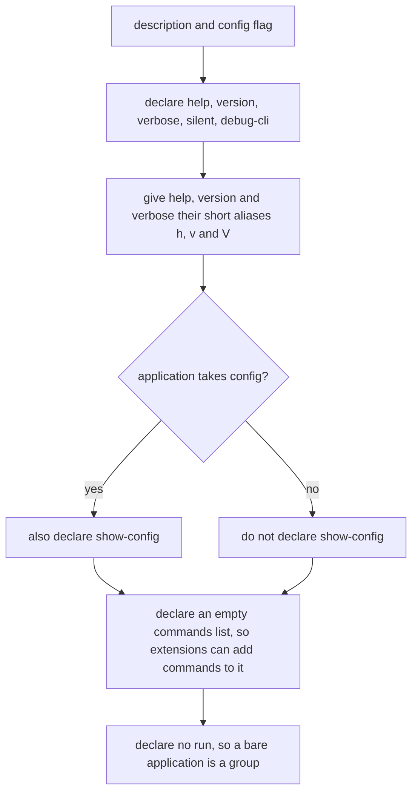

# Built-in commands

Governs `src/builtin/` — the command `clibuilder` ships to every application it
builds. `base_command.ts` carries the global options every invocation gets. The
plugin commands that used to sit beside it live in `@clibuilder/plugins`.

## What

Every application gets one thing it did not write. The **base command** is the
invisible root carrying the options every CLI is expected to have — help,
version, the logging levels — so that no author has to declare `--help` and no
user has to wonder whether this particular CLI supports it.

The base command's option set is not fixed: `--show-config` appears only on an
application that actually takes configuration, so a CLI never advertises an
option that could not do anything. The global `--format` appears only when the
format is active.

**Non-goals.** How a command is matched and run belongs to `execution/`. The
rendering primitives — the TOON encoders, the prose reporter, the `--format`
option itself — belong to `presentation/`. The `plugins list` and `plugins
search` commands, and how plugin packages are resolved and activated, belong to
`@clibuilder/plugins` (`packages/plugins`, its `commands/` and `loading/` nodes);
they were removed from core in v12.

**Key terms.** The **base command** is the nameless root command. A **format**
is the reader's chosen output shape.

## Use Cases

**Actors.**

| Actor | Reaches this capability | Goal |
| --- | --- | --- |
| CLI author | gets the base command for free | not declare `--help`, `--version` or the logging options |
| `execution` | installs the base command | have the global options present on every application |
| Extension author | adds commands to the base command's `commands` list | contribute commands to a CLI without compiling against it |

### UC1 — `getBaseCommand`: the global options every application carries

**Actor / goal.** `execution` wants the root command carrying the options a
user expects of any CLI.

| | |
| --- | --- |
| Trigger | `getBaseCommand(description, { config, format })` |
| Inputs | the application's description, whether it takes configuration, and the CLI's format when the global `--format` is active |
| Outcome | a nameless command declaring the global options |

**Extensions.** `--show-config` is declared only when the application takes
configuration. `--format <toon|json|text>` is declared only when the global
format is active (under `output: 'axi'` or `cli({ format })`), defaulting to the
CLI's format, with no `-f` alias ([axi-native RFC](../../../../../docs/rfcs/axi-native.md) section 3.4). The base command declares no `run`, so an application with no
default command is a group like any other: invoked bare, it takes
`execution/`'s no-`run` path, which shows help and exits with the usage code
([#609](https://github.com/clibuilder/clibuilder/issues/609)).

**Surface trace.**

| Element | Required by | May not combine with |
| --- | --- | --- |
| `getBaseCommand` | UC1 | — |
| `--help` / `--version` / `--verbose` / `--silent` / `--debug-cli` | UC1 | — |
| the `h` / `v` / `V` aliases | UC1 | — (`--silent` and `--debug-cli` carry none) |
| the base command's own empty `commands` list | UC1 — so extensions can add commands to it | — |
| `--show-config` | UC1 | an application declaring no config — it is not declared there |
| the global `--format` | UC1 | — (declared only under `output: 'axi'` or `cli({ format })`) |

## Control Flow

### Sub-graph A — the base command, entered by UC1

The base command declares no `run`. What a bare application then does is
`execution/`'s decision for any command without a `run`; what this node owns is
the declaration.

## Scenario map

### UC1 — `getBaseCommand`

| Edge | Path (Given) | Scenario |
| --- | --- | --- |
| declare help, version, verbose, silent, debug-cli | any | `every application declares help, version, and the logging options` |
| declare an empty commands list | any | `the base command declares an empty commands list for extensions to be added to` |
| give help, version and verbose their short aliases | any | `the global options carry their conventional short aliases` |
| `--silent` and `--debug-cli` carry none | any | `silent and debug-cli carry no short alias` |
| also declare show-config | the application takes config | `an application taking config also declares show-config` |
| do not declare show-config | the application takes no config | `an application taking no config does not advertise show-config` |
| declare no run | any | `the base command declares no run of its own` |
| the global format option | the format is active, and not | `the base command declares the global format option only when it is active` |
