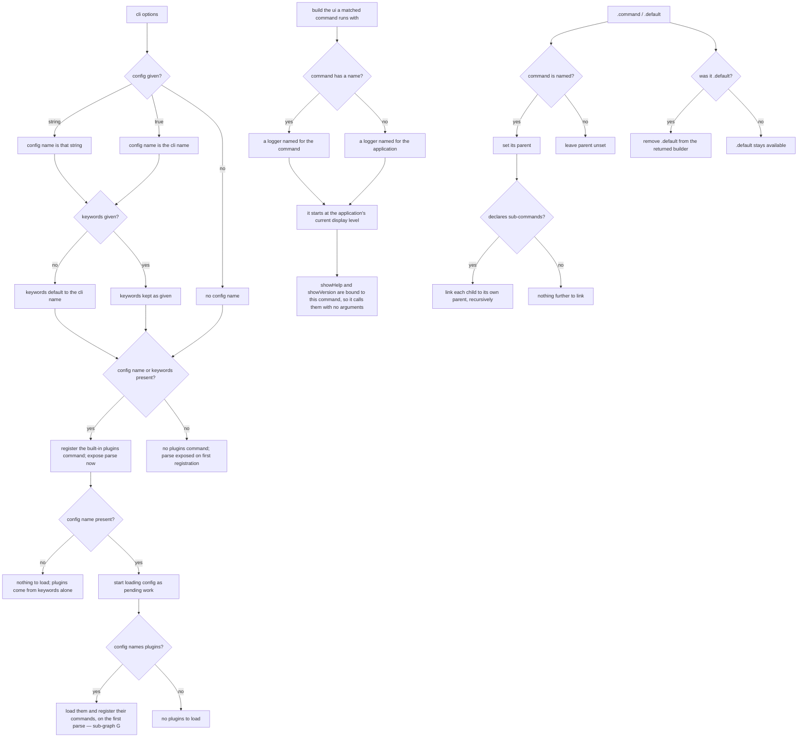
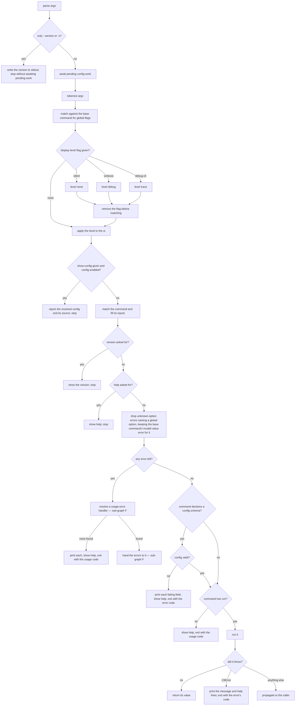
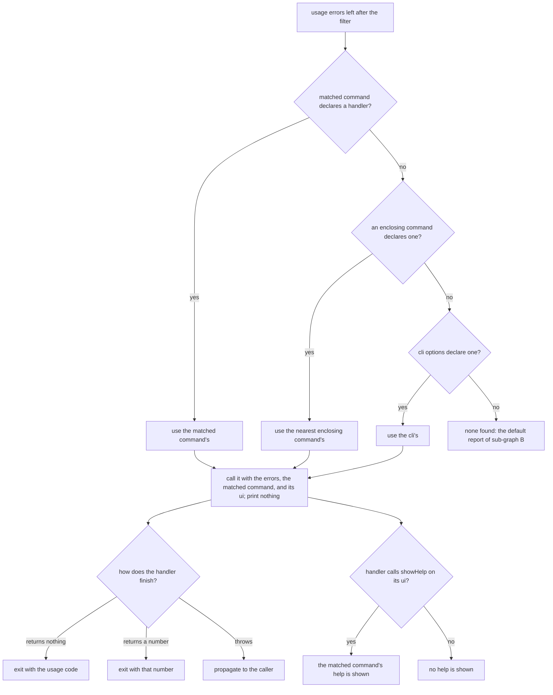
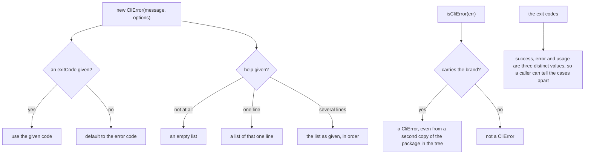
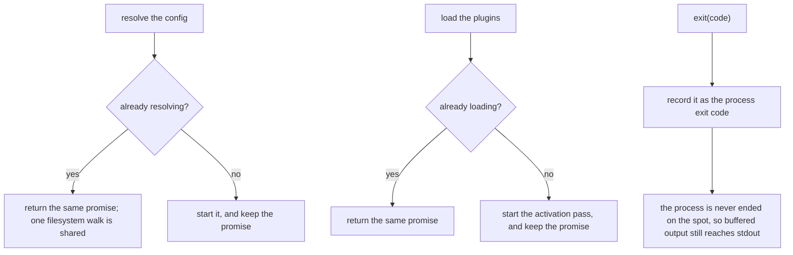
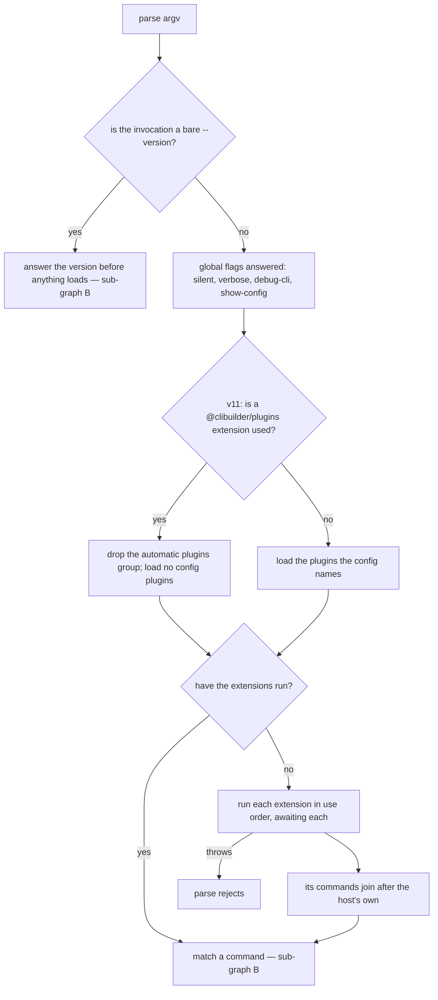

# Execution

Governs `src/cli.ts`, `src/app/`, and `src/drivers/context.ts`
— assembling an application from its declarations, running the matched command
with its context, and reporting failure as an exit code.

## What

This is the capability that turns a pile of declarations into a running
program. It has two halves separated in time. **Assembly** happens when the
author calls `cli(options)` and registers commands: state is derived from the
options, the built-in commands are installed, and any configuration and plugin
loading is started. **Invocation** happens when `parse(argv)` is called: the
global flags are answered, a command is matched, its inputs are checked, and it
is either run or refused.

Two design decisions run through the whole node. **Global flags are answered
before usage errors** — `--help` and `--version` are always valid, and telling a
confused user "unknown option" when they asked for help would be exactly
backwards. And **failure is an exit code, not an exception**: `parse` resolves
rather than rejecting, so a wrong invocation is reported to the user instead of
surfacing as an unhandled rejection with a stack trace.

The exit codes are the contract with a **non-human caller**. They follow the AXI
convention so that an agent or a script driving the CLI through a shell can tell
apart the three outcomes that matter — it worked, it was called correctly but
could not finish, it was called wrong and retrying identically will not help.

**Non-goals.** Classifying argv and coercing values belong to `input-parsing/`.
Finding and reading a config file belongs to `configuration/`; this node only
decides *when* to load one and what to do when it fails validation. Resolving
plugin packages belongs to `plugins/`. Rendering help text and messages belongs
to `presentation/`. What the built-in commands *do* belongs to
`builtin-commands/`.

**Key terms.** The **base command** is the invisible root carrying the global
options; every application has one. **Assembly** is everything before `parse`;
**pending work** is the config loading started during assembly that
`parse` must await. A **command instance** is a matched declaration bound to its
`ui`, `config`, `keywords`, `cwd`, and `registry`.

## Use Cases

**Actors.**

| Actor | Reaches this capability | Goal |
| --- | --- | --- |
| CLI author | `cli(options)`, `.command()`, `.default()`, `parse(argv)` | assemble an application from declarations and hand it argv |
| CLI author | `cli({ onUsageError })` | report every wrong invocation in one format of their choosing — for example a coded line an agent can read — instead of the framework's message and help |
| Command author | throws `CliError` from `run` | fail the CLI with a message the user can act on, and a chosen exit code |
| Command author, including a plugin author | declares `onUsageError` on a command | have a wrong invocation of their commands reported in their own format, whichever application hosts them |
| CLI end user | invokes the built program | reach the command they meant, or be told what was wrong and how to fix it |
| Agent or script driving the CLI through a shell | reads the process exit code | tell "it worked" from "it failed" from "I called it wrong" without parsing prose |
| `configuration` / `plugins` | are called during assembly and parse | be asked for their work once, at the right moment |

The agent is the stakeholder that justifies the three-way exit code split; a
capability reporting only success-or-failure would serve the human user equally
well and leave the agent unable to decide whether to retry.

### UC1 — `cli`: assemble an application

**Actor / goal.** A CLI author wants a runnable application derived from a name,
a version, and a statement of whether it takes configuration or plugins.

| | |
| --- | --- |
| Trigger | `cli(options)` |
| Inputs | `name`, `version`, optional `description`, `config`, `keywords`, `onUsageError` |
| Outcome | a builder; when the application can accept plugins, it is already executable |

**Extensions.**

| Cause | Outcome |
| --- | --- |
| `config` is `true` | the config name is the CLI's own name |
| `config` is a string | that string is the config name |
| `config` is omitted | there is no config name, and nothing is loaded for one |
| keywords are given | they are kept as given rather than defaulted |
| `config` is set and no keywords are given | the keywords default to the CLI's name, so plugin discovery has something to search for |
| the application can accept plugins | the built-in `plugins` command is registered, and `parse` is available immediately |
| the application takes neither config nor keywords | no `plugins` command, and `parse` becomes available only once a command is registered |
| the application declares keywords but no config name | nothing is loaded; the plugins to search for come from the keywords alone |
| the loaded config names no plugins | no plugin activation is attempted |
| a loaded config names plugins | their commands are registered before `parse` proceeds |

### UC2 — `.command()` / `.default()`: register commands

**Unserved goal — recovered from the issue tracker.** It has no entry point
today, so it appears in neither the Control Flow nor the suite:

| Actor | Goal | Provenance |
| --- | --- | --- |
| CLI author | be warned when a registered command's name or alias collides with an existing one, rather than silently having the first match win | [#109](https://github.com/clibuilder/clibuilder/issues/109) — closed without an implementation; no conflict detection exists in `src/app/` or `src/invocation/` |

**Actor / goal.** A CLI author wants their declarations installed into the
application's tree, with each command's place in that tree recorded.

| | |
| --- | --- |
| Trigger | `.command(cmd)` or `.default(cmd)` |
| Inputs | a command declaration |
| Outcome | the command is registered, its `parent` set, and the builder is executable |

**Extensions.** `.default()` may be called only once — the method is removed
from the builder it returns, so a second call is not offered, while `.command()`
leaves it in place. A **named** command has its `parent` set; a nameless one is
left unparented. A registered command's nested sub-commands are linked to their
own parent recursively, not to the root; a command declaring none has nothing
further linked, and the parent chain terminates at it.

Registration is also where a command's `ui` is built: on a logger named for the
command, falling back to the application's name when the command is nameless,
starting at the application's current display level, and with `showHelp` and
`showVersion` bound to that command so its `run` calls them with no arguments.

### UC3 — `parse`: run an invocation

**Actor / goal.** An end user wants the command they named to run with the
inputs they gave, or to be told precisely what was wrong.

| | |
| --- | --- |
| Trigger | `parse(argv)` |
| Inputs | the raw argv vector |
| Outcome | the matched command's return value |

**Extensions.**

| Cause | Outcome |
| --- | --- |
| a display-level flag is given | the level is set and the flag is removed before the command is matched, so it is never reported as unknown |
| `--show-config` on an application that takes config | the resolved config and its source are reported, and no command runs |
| `--show-config` on an application that takes no config | the option was never declared, so it is a usage error like any other unknown option |
| `--version` or `-v` is the only argument | the version is written to stdout as plain text and the CLI exits with success, **before** the pending config load is awaited and before the configured plugins or the `use()` extensions run, so a broken config or a hanging plugin or extension cannot fail or delay it. A rejection from the config load is marked handled. Nothing is loaded yet, so a bare `-v` is the version even if a plugin, an extension or the config declares `-v` ([axi-native RFC](../../../../../docs/rfcs/axi-native.md) section 3.8) |
| `--version` on the base command or the matched one, with any other argument | the version is shown after the pending work, and no command runs |
| `--help` on the base command or the matched one | help is shown, and no command runs — **before** any usage error is reported |
| an unknown-option error names a global option | it is dropped: the global options live on the base command, so a sub-command declaring none of its own would otherwise report them as unknown |
| an unknown-option error names a global option whose value the base command rejected | the base command's invalid-value error is reported in its place, so a malformed global flag fails under a sub-command as it does on the root (#614) |
| any usage error survives that filter, and no usage-error handler is declared | every error is printed, help is shown, and the CLI exits with the usage code |
| any usage error survives that filter, and a usage-error handler is declared | the handler reports it instead — see UC6 |
| the matched command declares a config schema and the config fails it | each failing field is printed, help is shown, and the CLI exits with the error code |
| the matched command declares no config schema | no validation runs and the command is reached directly |
| the matched command's `run` returns | its value is returned from `parse` |
| the matched command has no `run` | help is shown and the CLI exits with the usage code — a group command is not a runnable command, so invoking it bare is missing its sub-command ([#609](https://github.com/clibuilder/clibuilder/issues/609)). This includes an application with no default command. `--help` on a group is answered earlier and exits with success |
| `run` throws a `CliError` | its message and help lines are printed and the CLI exits with the error's own code |
| `run` throws anything else | it propagates to the caller — a defect in the command is not the framework's to swallow |

### UC4 — `CliError` and the exit codes: report a failure

**Actor / goal.** A command author wants to fail the CLI with a message,
optional guidance, and an exit code that says which kind of failure it was.

| | |
| --- | --- |
| Trigger | `throw new CliError(message, options)` from `run` |
| Inputs | a message; optionally an exit code, help lines, and a cause |
| Outcome | the message and help are printed, and the process exit code is set |

**Extensions.** The exit code defaults to the error code when none is given.
`help` may be one line or many and is normalized to a list. `isCliError` tests a
**brand**, not the class, so an error thrown by a duplicated copy of
`clibuilder` in the dependency tree is still recognized.

### UC5 — `context`: reach the outside world once

**Actor / goal.** The builder wants filesystem, process, and logging access it
can substitute in tests, and wants expensive resolution done once.

| | |
| --- | --- |
| Trigger | `context()` at construction |
| Inputs | the process's working directory |
| Outcome | a context carrying `cwd`, config and plugin loading, `exit`, and UI factories |

**Extensions.** Config resolution is cached **as a promise**, so concurrent
callers share one filesystem walk and a config that is legitimately falsy is not
re-resolved on every call. `exit` **records** `process.exitCode` rather than
calling `process.exit`, which would end the process on the spot and truncate
whatever is still buffered on stdout.

### UC6 — `onUsageError`: take over how usage errors are reported

**Actor / goal.** A CLI author, or the author of a command (a plugin's commands
included), wants a wrong invocation reported in a fixed format of their own —
on the stream they choose, with or without help — so a caller such as an agent
reads the same shape for every failure.

| | |
| --- | --- |
| Trigger | `parse(argv)` finds a usage error that survives the global-option filter (UC3) |
| Inputs | a handler declared on the matched command, on one of the commands enclosing it, or on `cli()`'s options |
| Outcome | the handler receives the errors, the matched command, and that command's `ui`; the framework prints nothing of its own; the CLI exits with the usage code |

A **usage error** is one entry of the list the parser produces; its kinds and
fields are defined by `input-parsing/` (UC2, `lookupCommand`). The **matched command**
is passed whole, so the handler can read the arguments and options it declares.

**Which handler.** The rule is one ordered lookup, first match wins:

1. the matched command's own handler;
2. otherwise the nearest enclosing command's, walking up the parent links;
3. otherwise the handler on `cli()`'s options;
4. otherwise none — the default report of UC3 applies.

A command a plugin adds is linked into the tree at registration like any other
(UC2), so the lookup treats it the same way: a handler on a plugin's group
command covers that group's sub-commands. A nameless command records no parent
(UC2), so the lookup goes from it straight to step 3. The **most specific handler
wins** because the command's author knows its options and codes; an application
wanting one format everywhere declares it on `cli()` and leaves commands bare.

**Extensions.**

| Cause | Outcome |
| --- | --- |
| no handler is found | the default report of UC3: every error printed, help shown, usage code |
| the handler returns nothing | the CLI exits with the usage code |
| the handler returns a number | the CLI exits with that number |
| the handler throws | the failure propagates to the caller — nothing is printed and no exit code is recorded |
| the handler calls its `ui`'s `showHelp` | the matched command's help is shown; help is the handler's choice, not the framework's |

### UC7 — `.use()`: extend the application

**Actor / goal.** An extension author — `@clibuilder/plugins` is the first —
wants to add commands and registry entries to an application they did not
write, before `parse` picks the command to run, without core knowing what the
extension is for.

| | |
| --- | --- |
| Trigger | `.use(extension)`, then `parse(argv)` |
| Inputs | an extension: a function of an `ExtensionContext` — `host`, `cwd`, `ui`, `registry`, `addCommand`, `resolveConfig` |
| Outcome | the extension's commands are registered after the host's own, and its registry entries are visible to every command |

The extensions run **on the first `parse` that needs the command tree**, not at
`.use()`: the host's own commands are registered by then, so an extension's
commands come after them, and constructing the application does no work on the
extension's behalf. They run **in the order `.use()` was called, each awaited
before the next**, so the command order is the same on every run — the rule
`loadPlugins` follows for plugins.

**v11 coexistence.** The extension `@clibuilder/plugins` returns carries a
marker. When one is used, assembly's config-driven plugin loading and its
automatic `plugins` group (UC1) are skipped, so nothing loads twice. Both, and
the marker check, are removed in v12 (slim-dependencies RFC section 9.8).

**Extensions.**

| Cause | Outcome |
| --- | --- |
| `.use()` is called | `parse` is available, because an extension may supply every command |
| several extensions are used | they run in the order `.use()` was called, each awaited before the next |
| an extension adds a command | it comes after the host's own `.command()` and `.default()` commands |
| the invocation is a bare `--version` or `-v` | it is answered before anything loads, so the extensions do not run — see UC3 |
| the invocation is `--help`, or names a command | the extensions run first, because the answer needs the command tree |
| `parse` is called again | the extensions do not run again |
| an extension throws | `parse` rejects with that error |
| an extension registers a value | a command reads it through `this.registry` |
| an extension logs through its `ui` | the message follows `--silent`, `--verbose`, and `--debug-cli` like the framework's own |
| the application sets no `config` | `resolveConfig` reports no source and no config |
| the application sets `config` | `resolveConfig` resolves it with where it came from |
| the `@clibuilder/plugins` extension is used | the config-driven plugin loading and the automatic `plugins` group are skipped |
| another extension is used | the config-driven plugin loading and the automatic `plugins` group stay |

**Surface trace.**

| Element | Required by | May not combine with |
| --- | --- | --- |
| `cli.Options.name` / `.version` | UC1 | — |
| `cli.Options.description` | UC1 (help text) | — |
| `cli.Options.config` | UC1, UC3 (`--show-config`) | — |
| `cli.Options.keywords` | UC1 (plugin discovery) | — |
| `cli.Options.onUsageError` | UC6 — the application-wide handler | — (a command's own handler takes precedence) |
| a command's `onUsageError` | UC6 — the per-command handler; its declaration is `command-definition/`'s | — (the nearest one in the chain is the only one called) |
| `cli.UsageError`, `cli.UsageErrorHandler` | UC6 — the handler's error entries and its signature, shared by both places it is declared | — |
| `.command` / `.default` | UC2 | `.default` with itself — offered once |
| `.use`, `Extension`, `ExtensionContext` | UC7 | — |
| `parse` | UC3 | — |
| `exitCodes` | UC4 | — |
| `CliError` and its options | UC4 | — |
| `isCliError` | UC4 | — |
| `context().exit` / `.resolveConfig` / `.loadPlugins` | UC5 | — |
| `context().createCommandUI` | UC2 — each command gets its own ui before it runs | — |

## Control Flow

### Sub-graph A — assembly, entered by UC1 and UC2

### Sub-graph B — invocation (`parse`), entered by UC3

### Sub-graph F — a usage-error handler, entered by UC6

"Enclosing" follows the parent links set at registration (UC2), so a command a
plugin adds, and its sub-commands, resolve exactly like the application's own.

### Sub-graph D — failing on purpose (`CliError`, `exitCodes`), entered by UC4

The brand is a shared symbol rather than the class, which is what makes the
check survive a duplicated `clibuilder` in the dependency tree — `instanceof`
would be comparing two different classes there.

### Sub-graph E — the outside world (`context`), entered by UC5

The cache holds the **promise**, not the resolved value, which is what makes it
correct for a config that is legitimately falsy as well as for concurrent
callers.

### Sub-graph G — extensions (`.use()`), entered by UC7

## Scenario map

### UC1 — `cli`: assemble an application

| Edge | Path (Given) | Scenario |
| --- | --- | --- |
| config name is that string | `config` is a string | `a string config option names the config file` |
| config name is the cli name | `config` is true | `config given as true names the config after the cli` |
| no config name | `config` omitted | `an application declaring no config has no config name` |
| keywords default to the cli name | config set, keywords omitted | `an application with config and no keywords searches under its own name` |
| keywords kept as given | keywords declared | `declared keywords are kept as given` |
| register the built-in plugins command; expose parse now | config name or keywords present | `an application that can accept plugins gets the built-in plugins command` |
| no plugins command | neither config nor keywords | `an application that cannot accept plugins gets no plugins command` |
| start loading config as pending work | a config name | `parse waits for the config started during assembly` |
| load them and register their commands | the loaded config names plugins | `commands from configured plugins are registered before parse proceeds` |
| nothing to load; plugins come from keywords alone | keywords declared and no config name | `an application with keywords and no config name loads no config` |
| no plugins to load | the loaded config names none | `a config naming no plugins activates none` |

### UC2 — register commands

| Edge | Path (Given) | Scenario |
| --- | --- | --- |
| set its parent | a named command registered | `a registered command records its parent` |
| leave parent unset | a command with no name | `a nameless command records no parent` |
| link each child to its own parent, recursively | a registered command declaring sub-commands | `nested sub-commands are linked to their own parent, not the root` |
| nothing further to link | a registered command declaring no sub-commands | `a command with no sub-commands has nothing further linked` |
| remove `.default` | `.default` was called | `the default command may be registered only once` |
| `.default` stays available | `.command` was called | `registering an ordinary command leaves default still available` |
| parse exposed on first registration | an application that cannot accept plugins | `registering a command makes the application executable` |

### UC3 — `parse`: run an invocation

| Edge | Path (Given) | Scenario |
| --- | --- | --- |
| level none, flag removed | `--silent` | `silent turns logging off and is not reported as unknown` |
| level debug, flag removed | `--verbose` | `verbose raises the log level and is not reported as unknown` |
| level trace, flag removed | `--debug-cli` | `debug-cli turns on framework logging and is not reported as unknown` |
| report the config and its source | `--show-config`, config enabled | `show-config reports the resolved config and where it came from` |
| show-config given and config enabled? — no | `--show-config`, config not enabled | `show-config on an application without config is an unknown option` |
| write the version to stdout; stop without awaiting pending work | `--version` alone, config loader rejects or never resolves | `version asked for alone is answered before config and plugins load` |
| write the version to stdout; stop without awaiting pending work | `-v` alone, plugin activation never finishes | `version asked for alone does not wait for plugin activation` |
| write the version to stdout; stop without awaiting pending work | `-v` alone, the default command declares `-v` | `the short version flag alone is the version even when a command declares it` |
| show the version | `--version` on the base command | `version asked of the application shows its version` |
| show the version | `--version` on the matched command | `version asked of a matched command shows the application version` |
| only --version or -v? — no | `--version` after a command, config declared | `version asked of a matched command waits for config and plugins` |
| show help | `--help`, with no other error | `help asked for shows help and runs nothing` |
| show help | `--help`, with a usage error also present | `help is answered even when the invocation is otherwise wrong` |
| drop unknown-option errors naming a global option | a sub-command declaring no options, given a global flag | `a global option given to a sub-command is not reported as unknown` |
| keep the base command's invalid-value error | a sub-command declaring no options, given a global flag with a malformed value | `a malformed value on a global option given to a sub-command is a usage error` |
| none found: print each, show help, exit usage | an unknown option that is not global, and no handler declared anywhere | `a usage error is printed with help and exits with the usage code` |
| print each failing field, exit error | matched command declares config, config invalid | `a config failing the command's schema is reported field by field` |
| config valid? — yes | matched command declares config, config valid | `a config satisfying the command's schema lets the command run` |
| command declares a config schema? — no | matched command declares no config schema | `a command declaring no config schema does not validate the config` |
| show help, exit with the usage code | matched command has no `run` | `a group command invoked bare shows help and exits with the usage code` |
| return its value | a runnable command, no errors | `a matched command runs and its value is returned` |
| print the message and help lines; exit with the error's code | `run` throws `CliError` | `a command failing with CliError is reported and sets its exit code` |
| propagate | `run` throws anything else | `a command throwing anything else propagates to the caller` |

### UC4 — `CliError` and the exit codes

| Edge | Path (Given) | Scenario |
| --- | --- | --- |
| default to the error code | no exit code given | `a CliError with no exit code uses the error code` |
| use the given code | an exit code given | `a CliError carries the exit code it was given` |
| an empty list | no help given | `a CliError with no help carries an empty list` |
| a list of that one line | help given as one line | `a single help line is carried as a list of one` |
| the list as given, in order | help given as several lines | `several help lines are carried in order` |
| carries the brand? — yes | an error from a duplicated copy of the package | `an error from a second copy of clibuilder is still recognized` |
| carries the brand? — no | a plain Error | `an ordinary error is not mistaken for a CliError` |
| success, error and usage are three distinct values | any | `success, error, and usage are three distinct exit codes` |

### UC2 — the ui a command runs with

| Edge | Path (Given) | Scenario |
| --- | --- | --- |
| a logger named for the command | a named command | `a command's messages are logged under its own name` |
| a logger named for the application | the nameless base command | `the nameless base command logs under the application's name` |
| it starts at the application's current display level | any command | `a command's ui starts at the application's display level` |
| showHelp and showVersion are bound to this command | any command | `a command calls showHelp with no arguments and gets its own help` |

### UC5 — `context`

| Edge | Path (Given) | Scenario |
| --- | --- | --- |
| return the same promise; one filesystem walk is shared | config already being resolved | `concurrent config resolution shares one filesystem walk` |
| start it, and keep the promise | config not yet being resolved | `the first config resolution starts the walk and keeps its promise` |
| start the activation pass, and keep the promise | plugins not yet being loaded | `the first plugin load starts the activation pass and keeps its promise` |
| return the same promise | plugins already being loaded | `concurrent plugin loading shares one activation pass` |
| record it as the process exit code | `exit` called | `exiting records the code rather than ending the process` |

### UC6 — `onUsageError`

| Edge | Path (Given) | Scenario |
| --- | --- | --- |
| use the matched command's | the matched command, its enclosing command, and the cli each declare a handler | `the matched command's own handler takes over its usage errors` |
| use the nearest enclosing command's | the matched command declares none; its enclosing command and the cli each declare one | `an enclosing command's handler takes over its sub-command's usage errors` |
| use the nearest enclosing command's | the matched command was added by a plugin under a group declaring a handler | `a handler on a plugin's group takes over its sub-command's usage errors` |
| use the cli's | only the cli declares a handler | `the cli's handler takes over when no command in the chain declares one` |
| call it with the errors, the matched command, and its ui; print nothing | any handler found | `a handler receives each error and the matched command, and the framework prints nothing` |
| exit with the usage code | the handler returns nothing | `a handler that returns nothing leaves the usage exit code` |
| exit with that number | the handler returns a number | `a handler that returns an exit code sets it` |
| propagate to the caller | the handler throws | `a handler that throws propagates to the caller` |
| the matched command's help is shown | the handler calls showHelp | `a handler that asks for help gets the matched command's help` |
| no help is shown | the handler reports and returns | `a handler that does not ask for help shows none` |

### UC7 — `.use()`

| Edge | Path (Given) | Scenario |
| --- | --- | --- |
| `parse` is available | an application with only an extension | `an application with an extension can parse` |
| run each extension in use order, awaiting each | two extensions, the first asynchronous | `extensions run in use order, each awaited before the next` |
| its commands join after the host's own | a host command and an extension command | `an extension's commands come after the host's own` |
| answer the version | a bare `--version` | `a bare version is answered without running the extensions` |
| is the invocation a bare --version? no | a command followed by `--version` | `version after a command runs the extensions` |
| run each extension | `--help` | `help lists the commands extensions add` |
| have the extensions run? yes | `parse` called twice | `extensions run once however often parse is called` |
| parse rejects | an extension that throws | `an error thrown by an extension rejects parse` |
| the context | any extension | `an extension is told its host and working directory` |
| the context | an extension registering a value | `an extension shares the registry with the commands` |
| the context | an extension logging at debug | `an extension logs through the framework ui` |
| the context | no `config` | `resolveConfig reports no source when the application sets no config` |
| the context | `config` set | `resolveConfig resolves the application config and its source` |
| drop the automatic plugins group; load no config plugins | the `@clibuilder/plugins` extension | `the plugins extension replaces the config-driven plugin loading` |
| drop the automatic plugins group | the `@clibuilder/plugins` extension | `the plugins extension replaces the automatic plugins group` |
| load the plugins the config names | another extension | `another extension leaves the config-driven plugin loading in place` |
