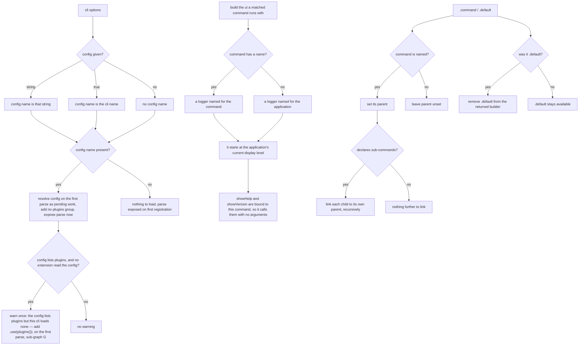
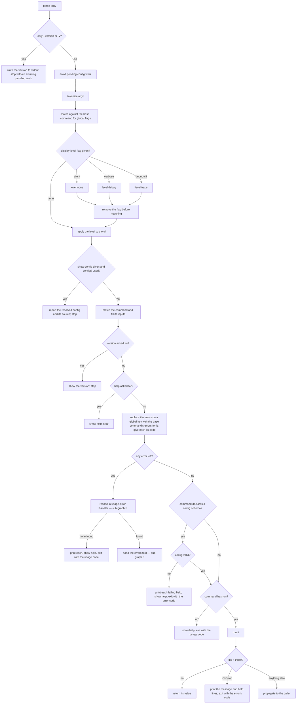
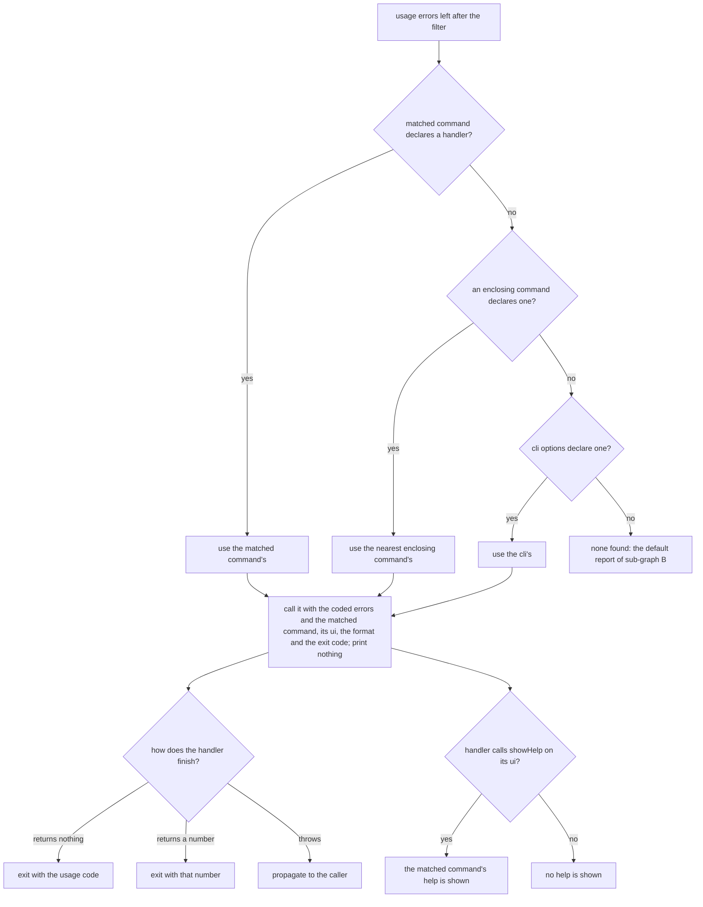
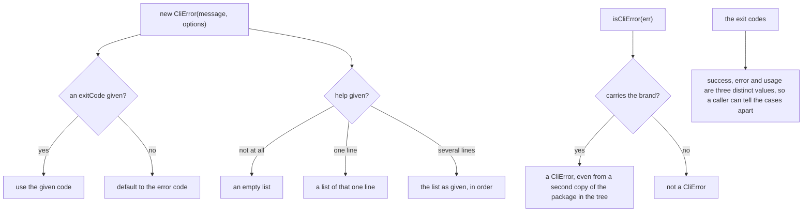
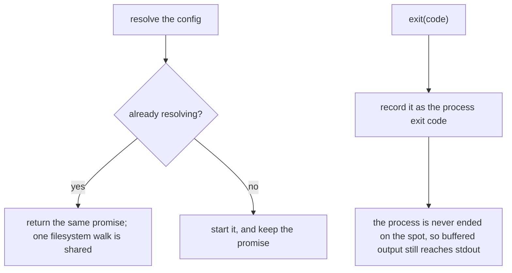
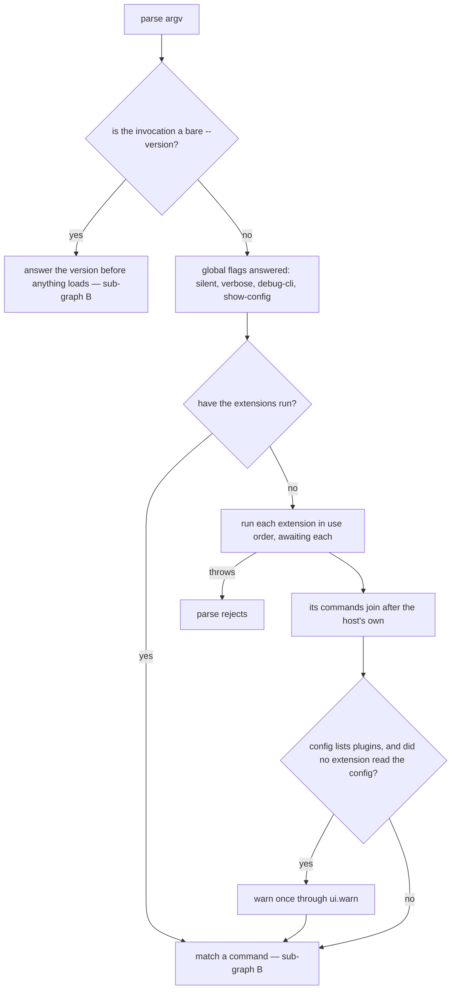

# Execution

Governs `src/cli.ts`, `src/app/`, and `src/drivers/context.ts`
— assembling an application from its declarations, running the matched command
with its context, and reporting failure as an exit code.

## What

This is the capability that turns a pile of declarations into a running
program. It has two halves separated in time. **Assembly** happens when the
author calls `cli(options)` and registers commands: state is derived from the
options, the built-in commands are installed, and any configuration loading is
started. **Invocation** happens when `parse(argv)` is called: the
global flags are answered, a command is matched, its inputs are checked, and it
is either run or refused.

Two design decisions run through the whole node. **Global flags are answered
before usage errors** — `--help` and `--version` are always valid, and telling a
confused user "unknown option" when they asked for help would be exactly
backwards. And **failure is an exit code, not an exception**: `parse` resolves
rather than rejecting, so a wrong invocation is reported to the user instead of
surfacing as an unhandled rejection with a stack trace.

The exit codes are the contract with a **non-human caller**. They follow the AXI
convention so that an agent or a script driving the CLI through a shell can tell
apart the three outcomes that matter — it worked, it was called correctly but
could not finish, it was called wrong and retrying identically will not help.

**Non-goals.** Classifying argv and coercing values belong to `input-parsing/`.
Finding and reading a config file belongs to `configuration/`; this node only
decides *when* to load one and what to do when it fails validation. Resolving
and activating plugin packages belongs to `@clibuilder/plugins`; core offers
them the registry (`registry/`) and `.use()` (UC7). Rendering help text and messages belongs
to `presentation/`. What the built-in commands *do* belongs to
`builtin-commands/`.

**Key terms.** The **base command** is the invisible root carrying the global
options; every application has one. **Assembly** is everything before `parse`;
**pending work** is the config that `.use(config())` resolves on the first
`parse`, which `parse` awaits. A **command instance** is a matched declaration bound to its
`ui`, `config`, `cwd`, and `registry`.

## Use Cases

**Actors.**

| Actor | Reaches this capability | Goal |
| --- | --- | --- |
| CLI author | `cli(options)`, `.command()`, `.default()`, `parse(argv)` | assemble an application from declarations and hand it argv |
| CLI author | `cli({ onUsageError })` | report every wrong invocation in one format of their choosing — for example a coded line an agent can read — instead of the framework's message and help |
| Command author | throws `CliError` from `run` | fail the CLI with a message the user can act on, and a chosen exit code |
| Command author, including an extension author | declares `onUsageError` on a command | have a wrong invocation of their commands reported in their own format, whichever application hosts them |
| CLI end user | invokes the built program | reach the command they meant, or be told what was wrong and how to fix it |
| Agent or script driving the CLI through a shell | reads the process exit code | tell "it worked" from "it failed" from "I called it wrong" without parsing prose |
| `configuration` / extensions | are called during assembly and parse | be asked for their work once, at the right moment |

The agent is the stakeholder that justifies the three-way exit code split; a
capability reporting only success-or-failure would serve the human user equally
well and leave the agent unable to decide whether to retry.

### UC1 — `cli`: assemble an application

**Actor / goal.** A CLI author wants a runnable application derived from a name,
a version, and, through `.use(config())` from `clibuilder/config`, whether it takes configuration.

| | |
| --- | --- |
| Trigger | `cli(options)` |
| Inputs | `name`, `version`, optional `description`, `onUsageError`. The `config` option is removed: config loads through `.use(config())` |
| Outcome | a builder; nothing is loaded until the first `parse` |

**Extensions.**

| Cause | Outcome |
| --- | --- |
| `.use(config())` is called | the config name is the CLI's own name |
| `.use(config({ name }))` is called | that name is the config name |
| `.use(config())` is not called | there is no config loader, and nothing is loaded |
| `.use(config())` is called | the config is loaded on the first `parse`, not at `cli()`, for the commands. No `plugins` command group is added, and `parse` is available immediately, so `--show-config` and `--help` work with no command registered |
| `.use()` is not called | `parse` becomes available only once a command is registered |
| a command declares `config`, and the cli has no `.use(config())` | a type error when `.command()` or `.default()` follows `.use(config())`; at run time the cli fails with `command 'x' declares config, but the cli does not load config. Add .use(config()) from 'clibuilder/config' to the cli.` |
| the loaded config lists plugins, and no `.use()` extension read the config through `resolveConfig()` (as `plugins()` does, after `config()`) | the cli warns once, through `ui.warn`, that the config lists plugins but this cli loads none, and to add `.use(plugins())` from `@clibuilder/plugins`. Plugin loading moved out of core in v12 |
| an extension read the config | no warning: something is handling the `plugins` list |
| the loaded config lists no plugins | no warning |

### UC2 — `.command()` / `.default()`: register commands

**Unserved goal — recovered from the issue tracker.** It has no entry point
today, so it appears in neither the Control Flow nor the suite:

| Actor | Goal | Provenance |
| --- | --- | --- |
| CLI author | be warned when a registered command's name or alias collides with an existing one, rather than silently having the first match win | [#109](https://github.com/clibuilder/clibuilder/issues/109) — closed without an implementation; no conflict detection exists in `src/app/` or `src/invocation/` |

**Actor / goal.** A CLI author wants their declarations installed into the
application's tree, with each command's place in that tree recorded.

| | |
| --- | --- |
| Trigger | `.command(cmd)` or `.default(cmd)` |
| Inputs | a command declaration |
| Outcome | the command is registered, its `parent` set, and the builder is executable |

**Extensions.** `.default()` may be called only once — the method is removed
from the builder it returns, so a second call is not offered, while `.command()`
leaves it in place. A **named** command has its `parent` set; a nameless one is
left unparented. A registered command's nested sub-commands are linked to their
own parent recursively, not to the root; a command declaring none has nothing
further linked, and the parent chain terminates at it.

Registration is also where a command's `ui` is built: on a logger named for the
command, falling back to the application's name when the command is nameless,
starting at the application's current display level, and with `showHelp` and
`showVersion` bound to that command so its `run` calls them with no arguments.

### UC3 — `parse`: run an invocation

**Actor / goal.** An end user wants the command they named to run with the
inputs they gave, or to be told precisely what was wrong.

| | |
| --- | --- |
| Trigger | `parse(argv)` |
| Inputs | the raw argv vector |
| Outcome | the matched command's return value |

**Extensions.**

| Cause | Outcome |
| --- | --- |
| a display-level flag is given | the level is set and the flag is removed before the command is matched, so it is never reported as unknown |
| `--show-config` on an application with `.use(config())` | the resolved config and its source are reported, and no command runs |
| `--show-config` on an application with `.use(config())`, in `axi` output | it is an answer: written to stdout whatever the display level, in the resolved format, with nothing on stderr from it, exit 0. `text` is the `console` rendering (`config: <source>` then the config as indented JSON); `toon` and `json` encode `{ source, path, property, config }`, where `source` is `file`, `package.json` or `none`, `path` and `property` are present only for the sources that have them, and `config` is `null` when nothing matched |
| `--show-config` on an application with `.use(config())`, in `console` output | the same lines as the `axi` `text` answer, written through `ui.info`, as in v11 |
| `--show-config` on an application without `.use(config())` | the option was never declared, so it is a usage error like any other unknown option |
| `--version` or `-v` is the only argument | the version is written to stdout as plain text and the CLI exits with success, **before** the pending config load is awaited and before the `use()` extensions run, so a broken config or a hanging extension cannot fail or delay it. A rejection from the config load is marked handled. Nothing is loaded yet, so a bare `-v` is the version even if an extension or the config declares `-v` ([axi-native RFC](../../../../../docs/rfcs/axi-native.md) section 3.8) |
| `--version` on the base command or the matched one, with any other argument | the version is shown after the pending work, and no command runs |
| `--help` on the base command or the matched one | help is shown, and no command runs — **before** any usage error is reported. The matched command's own `help` and `version` flags are read first (`peekFlags`), before its other declarations convert, so an async converter or check never delays the answer |
| any invocation | the global options (`help`, `version`, `verbose`, `silent`, `debug-cli`, `show-config`) and the format are resolved from the **base command's** lookup alone, converted synchronously (`convertDescriptorsSync`), before the matched command's usage errors are looked at ([axi-native RFC](../../../../../docs/rfcs/axi-native.md) section 3.2). The format is the caller's `--format`, else the `cli({ format })` value, `toon` by default |
| any invocation, in either output | the base command declares `--format <toon\|json\|text>`, with no `-f` alias, defaulting to the CLI's format (`toon` when `cli({ format })` is unset); every command accepts it, help shows it once with the global options, and `run()` reads the resolved value as `this.format` ([axi-native RFC](../../../../../docs/rfcs/axi-native.md) section 3.4) |
| `--format` is given a value other than toon, json or text, or more than once | it is a usage error on the global key, code `invalid-value` (or `expect-single`), naming the option, the raw value and the allowed formats; the format falls back to the CLI's default, so the error is reported in that and cannot loop, and it flows through the usage-error report below |
| a command declares its own `format` option, in either output | the CLI fails at startup — when the command is added, or when an extension adds it — with an error pointing at axi-native RFC section 3.4 that says to delete the local declaration and read `this.format`. The `plugins` commands of `@clibuilder/plugins` mark their own option as giving way with core's `defersToGlobalFormat` marker: it is dropped from the command, and they read `this.format` |
| a global option comes before the command path or inside it (`app --verbose show`, `app --format json group sub`) | it applies as it does after the command: the base command passes to the lookup as the fallback, so the option takes only the tokens its declaration says and the next token still names the command. A command's own option before the command ends the path there, so it stays an unknown option of the command reached so far |
| a usage error names a global key: one only the base command declares | base errors win for global keys: it is replaced by the base command's errors for that key. A well-formed global flag has none, so a sub-command declaring no options of its own does not report it as unknown; a malformed one is reported as the invalid value it is, once, as on the root (#614). A key the matched command declares itself is its own option, not the global one |
| any usage error survives that filter, and no usage-error handler is declared, in `console` output | every error is printed, help is shown, and the CLI exits with the usage code, as in v11 |
| any usage error survives that filter, no usage-error handler is declared, in `axi` output (the default) | core reports the **top-ranked** error alone, once, on stdout in the resolved format, writes nothing to stderr, shows no help, and the CLI exits with the usage code ([axi-native RFC](../../../../../docs/rfcs/axi-native.md) section 3.3). The rank is unknown option, conflicting options, invalid value, expect single, missing argument, extra arguments; the first of equal rank leads. The report is `error` (the message in the caller's terms), `code` (`unknown-option`, `conflicting-options`, `invalid-value`, `expect-single`, `missing-argument`, `extra-arguments`), the offending `option` (as typed, `--port`) or `argument` (its name), and the value as typed (`value`; `arguments` for extra arguments; `conflictsWith` for a conflict), then `help`: the command's usage line, the valid options for an unknown option or a missing option, the arguments (or a group's commands) for a missing or extra argument, and for `invalid-value` `allowed for --key: a, b, c (received "x")` for an enum or the global `--format`, else `expected for --key: <constraint> (received "x")` for a declaration. The global `--format` states its allowed values and no constraint |
| any usage error survives that filter, and a usage-error handler is declared | the handler reports it instead — see UC6 |
| the matched command declares a config schema and the config fails it, in `console` output | each failing field is printed, help is shown, and the CLI exits with the error code, as in v11. The schema is any Standard Schema, so its issues map to messages per dotted path of the issue, `(config)` for an issue without a path, the same in both output modes; a zod 3 schema (3.24 or later) works through `~standard` |
| the matched command declares a config schema and the config fails it, in `axi` output (the default) | core reports it once on stdout in the resolved format, code `invalid-config`, message `config fails validation`, with the messages for each failing key as a field named by the key's dotted path (`(config)` for the config as a whole; a key named `error`, `code` or `help` is written as `config.<key>`), shows no help, and the CLI exits with the error code |
| the matched command declares no config schema | no validation runs and the command is reached directly |
| the matched command's `run` returns | its value is returned from `parse`: the value `result()`, `document()` or `empty()` wraps, else the returned value itself. In `console` output nothing is printed for it, as in v11 |
| the matched command's `run` returns, in `axi` output (the default) | the returned value is the answer, printed once on stdout in the resolved format, nothing on stderr ([axi-native RFC](../../../../../docs/rfcs/axi-native.md) section 3.5). `undefined` prints nothing. A string, bare or from `document()`, is written verbatim, ending on one newline. An object is encoded; an array or a scalar is encoded under the `result` key, so every format reads one object and `help` has a place beside it. `result(value, { help, render })` adds `help` as the last key (omitted when empty) and a renderer for the format replaces the encoder, written verbatim and followed by the encoded `help` after a blank line. `empty(message, { help })` is encoded as `empty: <message>`, exit 0. An answer marked as already written (by `@clibuilder/axi`'s `output.result()`) prints nothing more |
| the matched command has no `run`, in `console` output | help is shown and the CLI exits with the usage code — a group command is not a runnable command, so invoking it bare is missing its sub-command ([#609](https://github.com/clibuilder/clibuilder/issues/609)). This includes an application with no default command. `--help` on a group is answered earlier and exits with success |
| the matched command has no `run`, in `axi` output (the default) | core reports it once on stdout in the resolved format, code `missing-command`, naming the `command` as typed (`app task`), with `help` holding its usage line and its valid sub-commands; no help is shown, and the CLI exits with the usage code. No usage-error handler is called for it, as before |
| `run` throws a `CliError`, in `console` output | its message and help lines are printed through `ui.error` and the CLI exits with the error's own code |
| `run` throws a `CliError`, in `axi` output (the default) | the report is encoded once on stdout in the resolved format (the caller's `--format`, else the CLI's), nothing is written to stderr for it, a debugging copy is a `debug` line, and the CLI exits with the error's own code |
| `run` throws a `CliError` from `CliError.reported()`, in either output | nothing is printed for it, and the CLI exits with the error's own code |
| `run` throws anything else | it propagates to the caller — a defect in the command is not the framework's to swallow |

### UC4 — `CliError` and the exit codes: report a failure

**Actor / goal.** A command author wants to fail the CLI with a message,
optional guidance, and an exit code that says which kind of failure it was.

| | |
| --- | --- |
| Trigger | `throw new CliError(message, options)` or `throw new CliError(report)` from `run` |
| Inputs | a message; optionally an exit code, a code, details, help lines, and a cause |
| Outcome | the report is printed (UC3 says where), and the process exit code is set |

The `CliError` is the structured report of the failure (axi-native RFC
section 3.1): `message`, `code` (a stable kebab-case string, `error` by
default), `details` (a flat record whose values are scalars or lists of
scalars, `{}` by default), `help` (a list) and `exitCode`.

**Extensions.** The exit code defaults to the error code when none is given.
It is any integer from 1 to 255; `0`, which would report a failure as success,
and anything else outside that range are rejected with a `RangeError` (section
3.6). A code that is not kebab-case is rejected, and so is a `details` key that
the report is rendered under (`error`, `code`, `help`). `details` and `help`
are copied, so a caller changing its own record later does not change the
error. `help` may be one line or many and is normalized to a list.
`CliError.reported(exitCode)` is a `CliError` for a failure already reported
elsewhere, such as by `@clibuilder/axi`'s `output.error()`: it carries the exit
code and renders nothing, which is what removes the double report in v11. `isCliError` tests a
**brand**, not the class, so an error thrown by a duplicated copy of
`clibuilder` in the dependency tree is still recognized.

### UC5 — `context`: reach the outside world once

**Actor / goal.** The builder wants filesystem, process, and logging access it
can substitute in tests, and wants expensive resolution done once.

| | |
| --- | --- |
| Trigger | `context()` at construction |
| Inputs | the process's working directory |
| Outcome | a context carrying `cwd`, config, `exit`, and UI factories |

**Extensions.** Config resolution is cached **as a promise**, so concurrent
callers share one filesystem walk and a config that is legitimately falsy is not
re-resolved on every call. `exit` **records** `process.exitCode` rather than
calling `process.exit`, which would end the process on the spot and truncate
whatever is still buffered on stdout.

### UC6 — `onUsageError`: take over how usage errors are reported

**Actor / goal.** A CLI author, or the author of a command (an extension's
commands included), wants a wrong invocation reported in a fixed format of their own —
on the stream they choose, with or without help — so a caller such as an agent
reads the same shape for every failure.

| | |
| --- | --- |
| Trigger | `parse(argv)` finds a usage error that survives the global-option filter (UC3) |
| Inputs | a handler declared on the matched command, on one of the commands enclosing it, or on `cli()`'s options |
| Outcome | the handler receives the errors, each with its `code`, and a context of the matched command, that command's `ui`, the resolved `format`, and the `exitCode` the CLI uses; the framework prints nothing of its own; the CLI exits with the usage code |

A **usage error** is one entry of the list the parser produces; its kinds and
fields are defined by `input-parsing/` (UC2, `lookupCommand`). Each error handed to
a handler also carries a stable kebab-case **`code`** next to its `type`:
`unknown-option` for `invalid-key`, and the same string as `type` for
`conflicting-options`, `invalid-value`, `expect-single`, `missing-argument` and
`extra-arguments` ([axi-native RFC](../../../../../docs/rfcs/axi-native.md) section 3.3).
In v11 `code` is not enumerable, so comparing or serializing an error gives what it did
before `code` existed. The **matched command** is passed whole, so the handler can read
the arguments and options it declares. `format` is the format the CLI reports in,
resolved with the global options before the handler runs, and `exitCode` is the code the
CLI exits with when the handler returns none (`exitCodes.usage`).

**Which handler.** The rule is one ordered lookup, first match wins:

1. the matched command's own handler;
2. otherwise the nearest enclosing command's, walking up the parent links;
3. otherwise the handler on `cli()`'s options;
4. otherwise none — the default report of UC3 applies.

A command an extension adds is linked into the tree at registration like any other
(UC2), so the lookup treats it the same way: a handler on an extension's group
command covers that group's sub-commands. A nameless command records no parent
(UC2), so the lookup goes from it straight to step 3. The **most specific handler
wins** because the command's author knows its options and codes; an application
wanting one format everywhere declares it on `cli()` and leaves commands bare.

**Extensions.**

| Cause | Outcome |
| --- | --- |
| no handler is found | the default report of UC3: every error printed, help shown, usage code |
| the handler returns nothing | the CLI exits with the usage code |
| the handler returns a number | the CLI exits with that number |
| the handler throws | the failure propagates to the caller — nothing is printed and no exit code is recorded |
| the handler calls its `ui`'s `showHelp` | the matched command's help is shown; help is the handler's choice, not the framework's |

### UC7 — `.use()`: extend the application

**Actor / goal.** An extension author — `@clibuilder/plugins` is the first —
wants to add commands and registry entries to an application they did not
write, before `parse` picks the command to run, without core knowing what the
extension is for.

| | |
| --- | --- |
| Trigger | `.use(extension)`, then `parse(argv)` |
| Inputs | an extension: a function of an `ExtensionContext` — `host`, `cwd`, `ui`, `registry`, `shared`, `addCommand`, `addGlobalOption`, `beforeRun`, `resolveConfig` |
| Outcome | the extension's commands are registered after the host's own, and its registry entries are visible to every command |

The extensions run **on the first `parse` that needs the command tree**, not at
`.use()`: the host's own commands are registered by then, so an extension's
commands come after them, and constructing the application does no work on the
extension's behalf. They run **in the order `.use()` was called, each awaited
before the next**, so the command order is the same on every run — the rule
that keeps command order deterministic.

**Extensions.**

| Cause | Outcome |
| --- | --- |
| `.use()` is called | `parse` is available, because an extension may supply every command |
| several extensions are used | they run in the order `.use()` was called, each awaited before the next |
| an extension adds a command | it comes after the host's own `.command()` and `.default()` commands |
| the invocation is a bare `--version` or `-v` | it is answered before anything loads, so the extensions do not run — see UC3 |
| the invocation is `--help`, or names a command | the extensions run first, because the answer needs the command tree |
| `parse` is called again | the extensions do not run again |
| an extension throws | `parse` rejects with that error |
| an extension registers a value | a command reads it through `this.registry` |
| an extension logs through its `ui` | the message follows `--silent`, `--verbose`, and `--debug-cli` like the framework's own |
| an extension adds a global option with `addGlobalOption` | it is listed with the other global options, and when the caller passes it, its `answer` runs instead of the command, after the logging flags apply |
| an extension adds a `beforeRun` hook | it runs before `run()` once the arguments are valid; it may set `run.config`, and fails the command by throwing a `CliError` |
| extensions share a value through `shared` | a later extension reads it; commands do not see it |
| extensions run | they run before the global options are resolved, and the `ui` messages they write are held until the logging flags apply |
| the application has no `.use(config())` | `resolveConfig` reports no source and no config |
| the application has `.use(config())` before the extension that asks | `resolveConfig` resolves it with where it came from |

**Surface trace.**

| Element | Required by | May not combine with |
| --- | --- | --- |
| `cli.Options.name` / `.version` | UC1 | — |
| `cli.Options.description` | UC1 (help text) | — |
| `config()` from `clibuilder/config` | UC1, UC3 (`--show-config`) | — |
| `cli.Options.onUsageError` | UC6 — the application-wide handler | — (a command's own handler takes precedence) |
| a command's `onUsageError` | UC6 — the per-command handler; its declaration is `command-definition/`'s | — (the nearest one in the chain is the only one called) |
| `cli.UsageError`, `cli.UsageErrorHandler` | UC6 — the handler's error entries and its signature, shared by both places it is declared | — |
| `.command` / `.default` | UC2 | `.default` with itself — offered once |
| `.use`, `Extension`, `ExtensionContext` | UC7 | — |
| `parse` | UC3 | — |
| `exitCodes` | UC4 | — |
| `CliError` and its options | UC4 | — |
| `CliError` as one report object, `CliError.Report` | UC4 | the `(message, options)` form |
| `CliError.code`, `CliError.details`, `CliError.Details` | UC4 | — |
| `CliError.reported` | UC4 | — |
| `cli.Options.format`, `cli.Format` | UC3 — the CLI's default format, the default of the global `--format` | — |
| the global `--format`, `this.format` | UC3 — in every CLI, in either output | a command's own `format` option — a startup error |
| `isCliError` | UC4 | — |
| `result`, `document`, `empty`, `Answer`, `Renderer` | UC3 — the result channel, printed in `axi` output, the default; the tagged answers are recognized by a `Symbol.for` key, so across copies of clibuilder | — |
| `this.output` | UC3 — the cli's output mode, `'axi'` by default | — |
| `context().exit` / `.resolveConfig` | UC5 | — |
| `context().createCommandUI` | UC2 — each command gets its own ui before it runs | — |

## Control Flow

### Sub-graph A — assembly, entered by UC1 and UC2

### Sub-graph B — invocation (`parse`), entered by UC3

### Sub-graph F — a usage-error handler, entered by UC6

"Enclosing" follows the parent links set at registration (UC2), so a command an
extension adds, and its sub-commands, resolve exactly like the application's own.

### Sub-graph D — failing on purpose (`CliError`, `exitCodes`), entered by UC4

The brand is a shared symbol rather than the class, which is what makes the
check survive a duplicated `clibuilder` in the dependency tree — `instanceof`
would be comparing two different classes there.

### Sub-graph E — the outside world (`context`), entered by UC5

The cache holds the **promise**, not the resolved value, which is what makes it
correct for a config that is legitimately falsy as well as for concurrent
callers.

### Sub-graph G — extensions (`.use()`), entered by UC7

## Scenario map

### UC1 — `cli`: assemble an application

| Edge | Path (Given) | Scenario |
| --- | --- | --- |
| config name is that string | `config({ name })` | `config given a name names the config file` |
| config name is the cli name | `config()` | `config given no name names the config after the cli` |
| no config name | no `.use(config())` | `an application without config() has no config name` |
| add no plugins group; expose parse now | `.use(config())` | `an application using config() loads it for its commands and adds no plugins group` |
| resolve config on the first parse as pending work | `.use(config())` | `parse resolves the config on its first call` |
| warn once | the loaded config lists plugins and no extension read the config | `a config listing plugins warns once when the cli loads none` |
| no warning | the loaded config lists plugins and an extension read the config | `an extension that reads the config silences the plugins warning` |
| no warning | the loaded config lists no plugins | `a config that lists no plugins does not warn` |

### UC2 — register commands

| Edge | Path (Given) | Scenario |
| --- | --- | --- |
| set its parent | a named command registered | `a registered command records its parent` |
| leave parent unset | a command with no name | `a nameless command records no parent` |
| link each child to its own parent, recursively | a registered command declaring sub-commands | `nested sub-commands are linked to their own parent, not the root` |
| nothing further to link | a registered command declaring no sub-commands | `a command with no sub-commands has nothing further linked` |
| remove `.default` | `.default` was called | `the default command may be registered only once` |
| `.default` stays available | `.command` was called | `registering an ordinary command leaves default still available` |
| parse exposed on first registration | an application declaring no config | `registering a command makes the application executable` |

### UC3 — `parse`: run an invocation

| Edge | Path (Given) | Scenario |
| --- | --- | --- |
| level none, flag removed | `--silent` | `silent turns logging off and is not reported as unknown` |
| level debug, flag removed | `--verbose` | `verbose raises the log level and is not reported as unknown` |
| level trace, flag removed | `--debug-cli` | `debug-cli turns on framework logging and is not reported as unknown` |
| report the config and its source | `--show-config`, `.use(config())` | `show-config reports the resolved config and where it came from` |
| report the config and its source | `--show-config`, `.use(config())`, output axi | `in axi output show-config is an answer on stdout in the resolved format` |
| report the config and its source | `--show-config`, `.use(config())`, output console | `in console output show-config is written through ui.info` |
| show-config given and config enabled? — no | `--show-config`, no `.use(config())` | `show-config on an application without config is an unknown option` |
| write the version to stdout; stop without awaiting pending work | `--version` alone, config loader rejects or never resolves | `version asked for alone is answered before config and extensions load` |
| write the version to stdout; stop without awaiting pending work | `-v` alone, the default command declares `-v` | `the short version flag alone is the version even when a command declares it` |
| show the version | `--version` on the base command | `version asked of the application shows its version` |
| show the version | `--version` on the matched command | `version asked of a matched command shows the application version` |
| only --version or -v? — no | `--version` after a command, config declared | `version asked of a matched command waits for config and extensions` |
| show help | `--help`, with no other error | `help asked for shows help and runs nothing` |
| show help | `--help`, with a usage error also present | `help is answered even when the invocation is otherwise wrong` |
| answer the structured help, encoded in the resolved format | output axi, `--help` on a command, a group or the root | `in axi output --help is an answer in the resolved format` |
| answer the text help, unchanged | output axi, `--help --format text` | `in axi output --help --format text is the text help, unchanged` |
| answer the help whatever the display level | output axi, `--help --silent` | `in axi output --help is answered under --silent` |
| answer the plain version, never encoded | output axi, `--version` bare or after a command, `--format json` | `in axi output --version is plain text in every format` |
| answer like `--help` | output axi, `run()` calls `ui.showHelp()` | `in axi output ui.showHelp from run answers like --help` |
| answer the plain version | output axi, `run()` calls `ui.showVersion()` | `in axi output ui.showVersion from run prints the plain version` |
| show them through the ui, as before | output console, `run()` calls `ui.showHelp()` and `ui.showVersion()` | `in console output ui.showHelp and ui.showVersion from run are unchanged` |
| replace the errors on a global key — none for a well-formed flag | a sub-command declaring no options, given a global flag | `a global option given to a sub-command is not reported as unknown` |
| replace the errors on a global key — the base command's invalid value | a sub-command declaring no options, given a global flag with a malformed value | `a malformed value on a global option given to a sub-command is a usage error` |
| resolve the global options before the usage errors | a sub-command given a display-level flag and an unknown option | `global flags apply before a sub-command's usage errors are reported` |
| replace the errors on a global key — reported once | a sub-command given a malformed global flag and an unknown option | `a malformed global option and a sub-command's own error are each reported once` |
| replace the errors on a global key — the command's own option | a sub-command declaring an option named like a global one | `a sub-command's own option named like a global one is not the global option` |
| a global option before the command path | a display-level flag before the command name or between a group and its sub-command | `a global flag before the command name applies and the command runs` |
| a global option before the command path | `--format` and its value before the command name, under output axi | `the global format before the command name sets the format the command runs in` |
| a global option before the command path, then show help | `--help` before the command name | `help asked before the command name shows that command's help` |
| a global option before the command path — a command's own option | a command's own option before its name | `a command's own option before the command name stays a usage error` |
| none found, `console` output: print each, show help, exit usage | an unknown option that is not global, and no handler declared anywhere | `a usage error is printed with help and exits with the usage code` |
| none found, `axi` output: the top-ranked error, coded, on stdout | each kind of usage error, alone | `in axi output a usage error is reported once on stdout with its code` |
| none found, `axi` output: rank | several usage errors at once | `in axi output only the top-ranked usage error is reported` |
| none found, `axi` output: what is valid | an invalid value of a t.enum, a t.int range or a t.string pattern | `in axi output an invalid value lists the allowed values or the violated constraint` |
| none found, `axi` output: in the resolved format | each format | `in axi output a usage error is encoded in the resolved format` |
| a handler found, `axi` output | a cli or a command handler | `in axi output a usage-error handler still takes over` |
| unchanged: print each, show help | a usage error, a bare group or a failing config, `console` output | `in console output usage errors, a bare group and a failing config are reported as before` |
| print each failing field, exit error | matched command declares config, config invalid, `console` output | `a config failing the command's schema is reported field by field` |
| `invalid-config` on stdout, exit error | the same, `axi` output | `in axi output a config failing the command's schema is one coded error` |
| config valid? — yes | matched command declares config, config valid | `a config satisfying the command's schema lets the command run` |
| command declares a config schema? — no | matched command declares no config schema | `a command declaring no config schema does not validate the config` |
| show help, exit with the usage code | matched command has no `run`, `console` output | `a group command invoked bare shows help and exits with the usage code` |
| `missing-command` on stdout, exit usage | matched command has no `run`, `axi` output | `in axi output a group command invoked bare is a missing-command error` |
| return its value | a runnable command, no errors | `a matched command runs and its value is returned` |
| print the message and help lines; exit with the error's code | `run` throws `CliError`, `console` output | `a command failing with CliError is reported and sets its exit code` |
| encode once on stdout, nothing on stderr | `run` throws `CliError`, `axi` output, each format | `in axi output a CliError is rendered once on stdout in the cli's format` |
| a debug line on stderr | the same, with `--verbose` | `in axi output a debugging copy of a CliError is a debug line` |
| unchanged | `run` throws `CliError`, `console` output, with a format | `in console output a CliError is reported on stderr as before` |
| nothing printed | `run` throws `CliError.reported()` | `a CliError already reported renders nothing` |
| reject at construction | `cli({ format })` outside toon, json, text | `a cli format other than toon, json or text is rejected` |
| the global `--format`, in console output | `console` output, no `cli({ format })` | `in console output the global format option is declared too` |
| the global `--format` | any output, with or without `cli({ format })` | `every cli accepts the global format option on every command` |
| `this.format` | `--format` passed or not | `run reads the resolved format as this.format` |
| a bad `--format` value | `--format yaml` | `a bad format value is a usage error reported in the default format` |
| a command's own `format` option | any output | `a command declaring its own format option fails the cli at startup` |
| encode in the resolved format | `run` throws `CliError`, `axi` output, `--format json` | `in axi output a CliError is rendered in the format of the invocation` |
| print the returned value once on stdout | `run` returns a value, `axi` output, each format | `in axi output a value returned from run is printed once in the resolved format` |
| print nothing | `run` returns `undefined`, `axi` output | `in axi output undefined prints nothing` |
| write verbatim | `run` returns a string, `axi` output | `in axi output a returned string is written verbatim` |
| wrap under `result` | `run` returns an array or a scalar, `axi` output | `in axi output an array or a scalar is encoded under the result key` |
| `help[N]` inside the result, renderer verbatim | `run` returns `result(value, { help, render })` | `result adds next steps and per-format renderers` |
| write verbatim | `run` returns `document(content)` | `document writes its content verbatim` |
| `empty: <message>`, exit 0 | `run` returns `empty(message)` | `empty is a success with an explicit empty state` |
| print nothing more | `run` returns an answer already written | `an answer already written is not printed again` |
| resolve to the value | any of the above | `parse resolves to the returned value` |
| unchanged: nothing printed | `run` returns a value, `console` output | `in console output a returned value is not printed` |
| propagate | `run` throws anything else | `a command throwing anything else propagates to the caller` |

### UC4 — `CliError` and the exit codes

| Edge | Path (Given) | Scenario |
| --- | --- | --- |
| default to the error code | no exit code given | `a CliError with no exit code uses the error code` |
| use the given code | an exit code given | `a CliError carries the exit code it was given` |
| an empty list | no help given | `a CliError with no help carries an empty list` |
| a list of that one line | help given as one line | `a single help line is carried as a list of one` |
| the list as given, in order | help given as several lines | `several help lines are carried in order` |
| carries the brand? — yes | an error from a duplicated copy of the package | `an error from a second copy of clibuilder is still recognized` |
| carries the brand? — no | a plain Error | `an ordinary error is not mistaken for a CliError` |
| success, error and usage are three distinct values | any | `success, error, and usage are three distinct exit codes` |
| accept 1 to 255 | exit code 1 or 255 | `a CliError accepts any exit code from 1 to 255` |
| reject | exit code 0, 256, negative or fractional | `a CliError rejects an exit code outside 1 to 255` |
| default code and details | no code or details given | `a CliError with no code or details uses the code error and no details` |
| reject | a code that is not kebab-case | `a CliError rejects a code that is not kebab-case` |
| reject | a details key `error`, `code` or `help` | `a CliError rejects a details key it is rendered under` |
| the same error | one report object | `a CliError can be constructed from one report object` |
| still a CliError | a subclass | `a subclass of CliError is a CliError` |
| exit code, renders nothing | `CliError.reported(exitCode)` | `CliError.reported carries an exit code and is marked as reported` |

### UC2 — the ui a command runs with

| Edge | Path (Given) | Scenario |
| --- | --- | --- |
| a logger named for the command | a named command | `a command's messages are logged under its own name` |
| a logger named for the application | the nameless base command | `the nameless base command logs under the application's name` |
| it starts at the application's current display level | any command | `a command's ui starts at the application's display level` |
| showHelp and showVersion are bound to this command | any command | `a command calls showHelp with no arguments and gets its own help` |

### UC5 — `context`

| Edge | Path (Given) | Scenario |
| --- | --- | --- |
| return the same promise; one filesystem walk is shared | config already being resolved | `concurrent config resolution shares one filesystem walk` |
| start it, and keep the promise | config not yet being resolved | `the first config resolution starts the walk and keeps its promise` |
| record it as the process exit code | `exit` called | `exiting records the code rather than ending the process` |

### UC6 — `onUsageError`

| Edge | Path (Given) | Scenario |
| --- | --- | --- |
| use the matched command's | the matched command, its enclosing command, and the cli each declare a handler | `the matched command's own handler takes over its usage errors` |
| use the nearest enclosing command's | the matched command declares none; its enclosing command and the cli each declare one | `an enclosing command's handler takes over its sub-command's usage errors` |
| use the nearest enclosing command's | the matched command was added by an extension under a group declaring a handler | `a handler on an extension's group takes over its sub-command's usage errors` |
| use the cli's | only the cli declares a handler | `the cli's handler takes over when no command in the chain declares one` |
| call it with the errors, the matched command, and its ui; print nothing | any handler found | `a handler receives each error and the matched command, and the framework prints nothing` |
| call it with the format and the exit code | any handler found | `a handler receives the resolved format and the usage exit code` |
| call it with the cli's format | `cli({ format })` given | `a handler receives the format the cli was built with` |
| call it with the coded errors | each kind of usage error | `each usage error a handler receives carries its stable code` |
| exit with the usage code | the handler returns nothing | `a handler that returns nothing leaves the usage exit code` |
| exit with that number | the handler returns a number | `a handler that returns an exit code sets it` |
| propagate to the caller | the handler throws | `a handler that throws propagates to the caller` |
| the matched command's help is shown | the handler calls showHelp | `a handler that asks for help gets the matched command's help` |
| no help is shown | the handler reports and returns | `a handler that does not ask for help shows none` |

### UC7 — `.use()`

| Edge | Path (Given) | Scenario |
| --- | --- | --- |
| `parse` is available | an application with only an extension | `an application with an extension can parse` |
| run each extension in use order, awaiting each | two extensions, the first asynchronous | `extensions run in use order, each awaited before the next` |
| its commands join after the host's own | a host command and an extension command | `an extension's commands come after the host's own` |
| answer the version | a bare `--version` | `a bare version is answered without running the extensions` |
| is the invocation a bare --version? no | a command followed by `--version` | `version after a command runs the extensions` |
| run each extension | `--help` | `help lists the commands extensions add` |
| have the extensions run? yes | `parse` called twice | `extensions run once however often parse is called` |
| parse rejects | an extension that throws | `an error thrown by an extension rejects parse` |
| the context | any extension | `an extension is told its host and working directory` |
| the context | an extension registering a value | `an extension shares the registry with the commands` |
| the context | an extension logging at debug | `an extension logs through the framework ui` |
| the context | no `.use(config())` | `resolveConfig reports no source when the application has no config()` |
| the context | `.use(config())` | `resolveConfig resolves the config() config and its source` |
