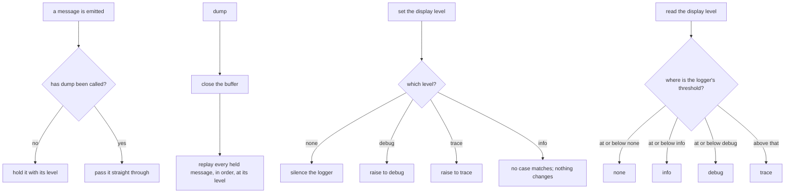
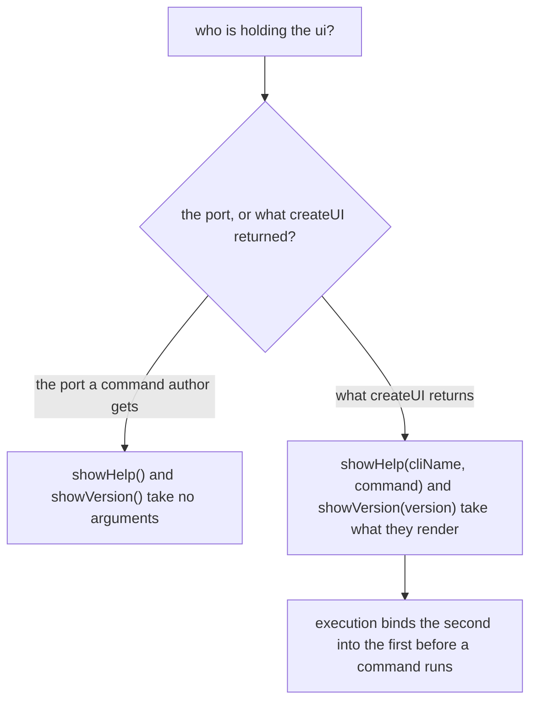
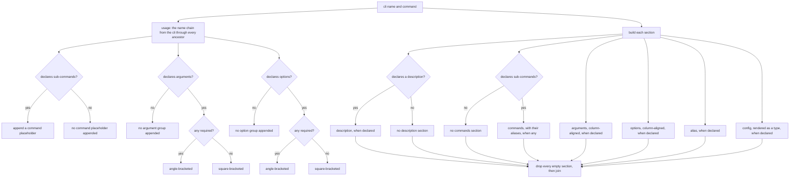
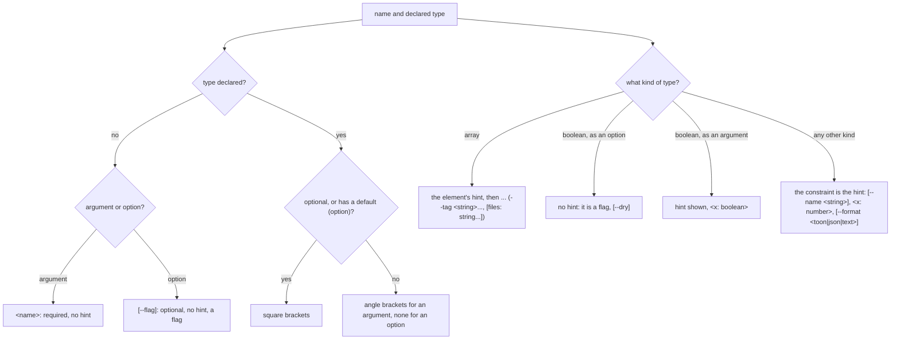
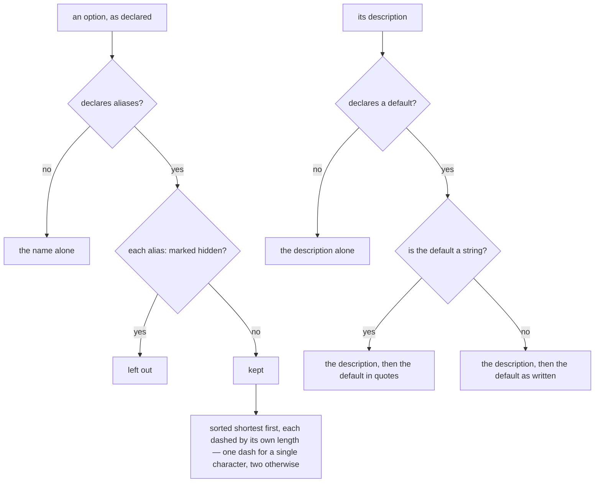
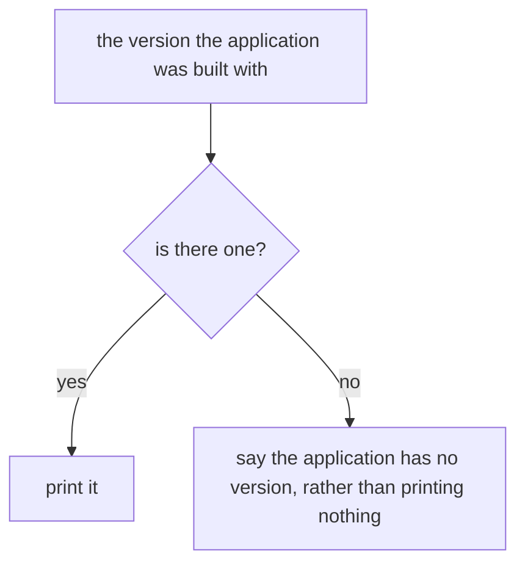
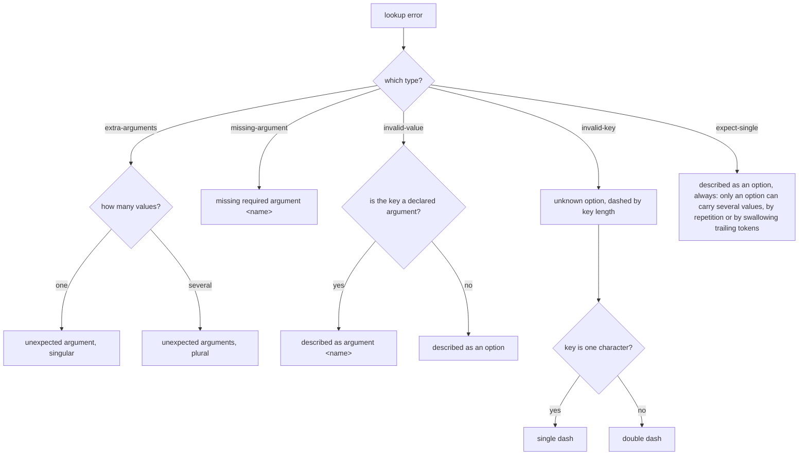

# Presentation

Governs `src/render/help.ts`, `src/render/error.ts`,
`src/drivers/logger.ts`, `src/drivers/stream_ui.ts`, `src/drivers/streams.ts`,
`src/render/encode.ts`, `src/render/text.ts` and `src/core/ports.ts` — rendering help and usage as text or as a value,
describing a usage error in words, emitting messages at their log level, and
encoding an answer in the format its reader asked for. Generating the text is pure and lives in `render/`; writing it is the
logger's, and `core/ports.ts` declares the `UI` a command author calls.

## What

Everything a CLI says passes through here. That splits into three jobs that look
unrelated but share one constraint: the CLI does not know who is reading.

**Messages** are emitted at a level, and the level is not known until argv has
been parsed — yet the framework has things to say before that. So the builder's
UI **buffers** every message and replays it once the level is settled, rather
than deciding too early and losing the ones it guessed wrong about.

**Help** is generated from the declaration, never written by hand. That is the
payoff for the framework reading declarations: a command that declares an
argument gets it documented, aligned, and marked required or optional without
its author writing a line of prose.

**Answers** are encoded in the format the reader asked for. The default is TOON
rather than prose, because a CLI's own metadata is read by an agent far more
often than by a person, and TOON is the cheaper read for one. It is a default,
not a replacement: `text` is the prose a human wants, and `json` is what
survives a pipe into `jq`. Counts are part of the TOON syntax, so a reader never
has to count entries or wonder whether a list was truncated. The helpers a
command used to call to render a collection (`toonArray`, `reportProse`) moved
to `@clibuilder/plugins`, with the commands that used them.

**Non-goals.** Deciding *when* to show help or what to report belongs to
`execution/`. What may be declared belongs to
`command-definition/`.

**Key terms.** The **display level** is how much the CLI says — none, info,
debug, or trace. A **signature** is a name as it appears in help, bracketed by
whether it is required and hinted with its type. **TOON** is the default
structured output shape; a **help line** is its trailing next-step suggestion.

## Use Cases

**Actors.**

| Actor | Reaches this capability | Goal |
| --- | --- | --- |
| CLI end user | reads help and messages | learn how to invoke the command without leaving the terminal |
| Agent or script | reads TOON or JSON output | parse the answer without branching on how many results there were |
| Command author | calls `this.ui.info` / `warn` / `error` | say something to the user at the right level |
| `execution` | calls `showHelp`, `showVersion`, `dump` | render at the moment it has decided to |
| `input-parsing` | hands over the usage errors it produced | have each failure described in the user's terms |

The agent is why the structured formats exist at all and why they are the
*default*; a capability serving only the terminal reader would have stopped at
prose.

### UC1 — `createBuilderUI`: say things before the level is known

**Actor / goal.** The framework wants to log during assembly, before argv has
told it how much to say.

| | |
| --- | --- |
| Trigger | messages emitted before `dump()` |
| Inputs | the message and its level |
| Outcome | the message is held, then replayed once the level is settled |

**Extensions.** After `dump()` the buffer is closed and messages pass straight
through; replay preserves both the order and the level each message was emitted
at.

### UC2 — the display level: control how much is said

**Actor / goal.** A user wants to turn logging off or turn diagnostics on.

| | |
| --- | --- |
| Trigger | setting or reading `displayLevel` |
| Inputs | one of none, info, debug, trace |
| Outcome | the underlying logger's threshold moves |

**Extensions.** Setting the level to `info` is a **no-op** — the setter has
cases for none, debug, and trace only. It is benign because the logger is
constructed at info, so the value is already what was asked for, but it means
the level cannot be lowered back to info once raised.

### UC3 — `showHelp`: render a command's help from its declaration

**Actor / goal.** A user wants to know how to invoke this command, and a command
author wants that without writing it.

| | |
| --- | --- |
| Trigger | `showHelp(cliName, command)` |
| Inputs | the application's name and the command declaration |
| Outcome | usage, description, commands, arguments, options, aliases, config, and examples, in that order |

**Extensions.**

| Cause | Outcome |
| --- | --- |
| a section has nothing to show | it is dropped, not rendered empty |
| the command is nested | usage names the whole chain from the application through every ancestor |
| the command declares sub-commands | usage says a command is expected, and they are listed with their aliases |
| an argument or option is required | usage marks the group with angle brackets rather than square ones |
| the command declares a config schema | the shape its JSON Schema describes is rendered as a type; a schema with no JSON Schema, such as zod 3, adds no `Config:` section |
| the command declares examples | each description is shown above its command line, verbatim |

### UC4 — the signature format: mark what is required and what it takes

**Actor / goal.** A reader scanning help wants to see at a glance whether
something is required and what kind of value it takes.

| | |
| --- | --- |
| Trigger | rendering an argument or option name into help |
| Inputs | the name and its declared type |
| Outcome | a bracketed signature with a type hint |

**Extensions.**

| Cause | Outcome |
| --- | --- |
| no type is declared | an argument is treated as required (`<name>`), an option as optional (`[--flag]`) — matching how each is filled |
| no type is declared | no type hint is shown beside the name, whichever the element is |
| the type is a scalar | the hint is the constraint: `[--name <string>]`, `<x: string>`, `[--port <int 1..65535>]` |
| the type is an array | a variadic marker is shown after the hint: `--abc <string>...`, `[x: number...]` |
| the type is a boolean **option** | no type hint — an option is a flag, so a hint would be noise |
| the type is a boolean **argument** | the hint is shown, because it is a value the user has to type out |
| the option declares aliases | they are shown with the name, shortest first, each dashed by its own length |
| an alias is marked hidden | it is left out |
| the option declares a default | the description names it, quoted when the default is a string, including the global `--format`: `(default 'toon')` beside `[--format <toon\|json\|text>]` |

### UC5 — `showVersion`: report the application's version

**Actor / goal.** A user checking which build they are running wants an answer
either way — including when the application has no version to give, which is
still information rather than a failure.

| | |
| --- | --- |
| Trigger | `showVersion(version)` |
| Inputs | the version, if the application has one |
| Outcome | the version, or a phrase saying there is none |

**Extensions.** An application built without a version says so rather than
printing nothing, which would read as a failure.

**Surface trace.**

| Element | Required by | May not combine with |
| --- | --- | --- |
| `createBuilderUI` / `dump` | UC1 | — |
| `createUI` and `displayLevel` | UC2 | — |
| `debug` / `info` / `warn` / `error` | UC1, UC2 | — |
| `showHelp` | UC3, UC4 | — |
| `showVersion` | UC5 | — |
| `formatLookupError` | UC7 | — |
| `UI` and `DisplayLevel`, the ports in `core/ports.ts` | UC2, UC3, UC5 — what a command author programs against | — |
| `BuilderUI` | UC1 — the buffered ui, `createUI.UI` plus `dump` | — |
| `createUI.UI` | UC3, UC5 — what the adapter returns, which is not the port | — |
| `generateHelpMessage` | UC3 — the help text `showHelp` renders | — |
| `cli({ streams })`, `Streams` in `core/ports.ts` | UC8 | — |
| `cli({ output })`, `Output` in `core/ports.ts` | UC8 | — |
| `createStreamUI` and the internal `routing` table | UC8 | — |
| `shouldColour` / `createSinks` | UC8 | — |
| `handleEpipe` | UC9 | — |
| `encode`, `Format`, `formats`, `errorOutput` in `render/encode.ts` | UC10 | — |
| `renderText` in `render/text.ts` | UC10 | — |

### UC10 — encode an answer in the cli's format

**Actor / goal.** The framework wants one place that turns a plain object into
text in `toon`, `json` or `text`, so a thrown `CliError` now, and `--format` and
returned values later, read the same. Design: axi-native RFC sections 3.1 and
3.4.

| Cause | Outcome |
| --- | --- |
| `toon` | the official `@toon-format/toon` encoder, for every value, single objects and errors included |
| `json` | `JSON.stringify` of the value, on one line |
| `text` | `key: value` lines, the same rendering as `@clibuilder/axi`'s `renderText` |
| an error report | flat: `error`, `code`, the `details` fields, then `help`, which is left out when empty |

Both modules import nothing from the framework (RFC section 4.1).

### UC11 — `generateHelpModel`: the help as a value

**Actor / goal.** An agent asks for `--help` under `--format toon` or `json` and wants the help it can parse,
not prose (axi-native RFC section 3.7).

| | |
| --- | --- |
| Trigger | `generateHelpModel(cliName, command, globalOptions)` |
| Inputs | the application's name, the command declaration, and the base command's options |
| Outcome | `name`, `usage`, `description`, `aliases`, `commands`, `arguments`, `options`, `config`, `examples`, `globalOptions`; a key with nothing to say is left out |

**Extensions.** It reads the same declaration data the text help reads, and nothing more: an option's type is the
descriptor's kind, left out for a declaration with no type, with its `min`, `max`, `pattern` or allowed
`values`. Sub-commands carry only their name, aliases and the first line of their description, so group help stays
compact. The global options are listed once, under `globalOptions`, and the root leaves them out of its `options`.
The text renderer is left as it was; a test proves the two agree.

### UC8 — the built-in ui: write to `cli({ streams })` by `cli({ output })`

**Actor / goal.** A CLI author wants the output on streams they choose, and an
agent reading stdout wants only answers there. Design: axi-native RFC sections
3.9 and 3.10, slim-dependencies RFC section 4.

| | |
| --- | --- |
| Trigger | `cli({ streams })` or `cli({ output })` |
| Inputs | two writable streams (the process streams by default) and an output mode |
| Outcome | each `ui` message written as one line to the stream its method routes to |

**Extensions.**

| Cause | Outcome |
| --- | --- |
| `output: 'axi'` (default) | every `ui` message on stderr |
| `output: 'console'` | `info` and `debug` on stdout, `warn` and `error` on stderr, as in v11 |
| `showHelp` / `showVersion` | stdout in either output: `--help` and `--version` are answers |
| the stream is not a TTY | no colour, whatever `FORCE_COLOR` says |
| the stream is a TTY | `FORCE_COLOR` decides when set (`0` or `false` is off), else a non-empty `NO_COLOR` turns colour off, else the terminal decides |
| no `streams` is given | the built-in ui writes to `process.stdout` and `process.stderr`, routed by the output mode (`axi` by default); it is the only engine since v12 removed standard-log |

The routing table behind each mode is internal; it is not a `cli()` option.
A line is the arguments joined by spaces with objects inspected and no printf
placeholders, which is the line `testCommand` has always captured.

### UC9 — EPIPE on the process stdout

**Actor / goal.** A user piping the CLI into `head` wants it to stop quietly
when the reader has had enough.

| Cause | Outcome |
| --- | --- |
| the reader of `process.stdout` closes early | later writes are dropped and the exit code is set to 0 |
| any other error on `process.stdout` | it is rethrown |
| a stream passed through `cli({ streams })` | not watched; it is the embedder's to handle |

### UC7 — `formatLookupError`: describe a usage error in words

**Actor / goal.** The CLI end user, reached through `input-parsing`, wants a
failed invocation explained in the terms they typed it in — which key, which
argument, how many values — rather than as an error record.

| | |
| --- | --- |
| Trigger | `formatLookupError(error, command)` |
| Inputs | one of the five lookup error types, and the command it was matched against |
| Outcome | a line naming what went wrong in the user's own vocabulary |

**Extensions.** An unknown key is dashed by its length, so a single character
reads as a short option and several as a long one. An extra-arguments error is
pluralized by how many values it carries. An invalid value names an argument or an option
depending on whether the key is a declared argument. A too-many-values error
always names an option: a non-array argument consumes exactly one positional, so
it can never carry the several values that raise one. An option gathers several
either by being repeated or by swallowing the bare tokens that follow it.

## Control Flow

### Sub-graph A — buffered messages and levels, entered by UC1 and UC2

The setter and the reader are not symmetric: the reader derives the level from
the logger's own threshold, which is why a level the setter ignored still reads
back as whatever the threshold actually is.

### Sub-graph G2 — the two shapes of `showHelp` and `showVersion`, entered by UC3 and UC5

The port and the adapter deliberately differ, and the difference is what lets a
command author write `this.ui.showHelp()` with nothing to hand it.

### Sub-graph B — generate help (`showHelp`), entered by UC3

### Sub-graph C — a signature (`formatOptionDescriptor`, `formatArgumentDescriptor`), entered by UC4

Every typed declaration is a `t` descriptor, so the signature reads the
descriptor's kind, constraint and optionality; a declaration with no type has a
fixed form.

### Sub-graph E — an option's name and description in help, entered by UC4

An argument renders its name alone; an option carries its aliases beside it and
may name a default. Both then go through sub-graph C for their brackets.

### Sub-graph F — report a version (`showVersion`), entered by UC5

### Sub-graph G — describe a usage error (`formatLookupError`), entered by UC7

## Scenario map

### UC1 — `createBuilderUI`

| Edge | Path (Given) | Scenario |
| --- | --- | --- |
| hold it with its level | before `dump` | `a message emitted before the level is settled is held rather than printed` |
| replay every held message, in order, at its level | `dump` called | `dumping replays every held message in order and at its own level` |
| pass it straight through | after `dump` | `a message emitted after dumping is printed straight away` |

### UC2 — the display level

| Edge | Path (Given) | Scenario |
| --- | --- | --- |
| silence the logger | level set to none | `setting the level to none silences the logger` |
| raise to debug | level set to debug | `setting the level to debug shows debug messages` |
| raise to trace | level set to trace | `setting the level to trace shows trace messages` |
| no case matches | level set to info | `setting the level to info changes nothing` |
| none | the level set to none | `reading the level back after silencing reports none` |
| debug | the level set to debug | `reading the level back after raising to debug reports debug` |
| trace | the level set to trace | `reading the level back after raising to trace reports trace` |
| info | a ui whose level has not been set | `a ui reports info before any level is set` |
| no case matches | the level set to info on a ui already raised | `setting the level to info leaves a level already raised where it was` |

### UC3 — `showHelp`

| Edge | Path (Given) | Scenario |
| --- | --- | --- |
| the name chain from the cli through every ancestor | a nested command | `usage names the whole chain from the application through every ancestor` |
| append a command placeholder | the command declares sub-commands | `usage says a command is expected when the command has sub-commands` |
| no command placeholder appended | no sub-commands declared | `usage says nothing about a command when none are declared` |
| no argument group appended | no arguments declared | `usage carries no argument group when none are declared` |
| no option group appended | no options declared | `usage carries no option group when none are declared` |
| angle-bracketed | at least one required argument | `usage marks arguments as required when any of them is` |
| square-bracketed | no required argument | `usage marks arguments as optional when none of them is required` |
| angle-bracketed | at least one required option | `usage marks options as required when any of them is` |
| square-bracketed | no required option | `usage marks options as optional when none of them is required` |
| description, when declared | the command declares one | `a declared description is shown` |
| commands, with their aliases | sub-commands declared, some with aliases | `sub-commands are listed with their aliases` |
| arguments, column-aligned | arguments declared | `declared arguments are listed with their descriptions, aligned` |
| options, column-aligned | options declared | `declared options are listed with their descriptions, aligned` |
| alias, when declared | the command declares aliases | `a command's own aliases are shown` |
| config, rendered as a type | a config schema declared | `a declared config schema is shown as a type` |
| no description section | no description declared | `a command with no description shows no description section` |
| no commands section | no sub-commands declared | `a command with no sub-commands shows no commands section` |
| drop every empty section | a command declaring almost nothing | `a section with nothing to show is left out rather than rendered empty` |
| examples, last, each description above its command line | examples declared | `declared examples are shown last, each description above its command line` |
| no examples section | no examples declared | `a command with no examples shows no examples section` |

### UC3 — the two ui shapes

| Edge | Path (Given) | Scenario |
| --- | --- | --- |
| `showHelp()` and `showVersion()` take no arguments | the port a command author holds | `the ui a command author calls needs no arguments to show help` |
| `showHelp(cliName, command)` takes what it renders | what `createUI` returns | `the ui createUI returns is told what to render` |

### UC4 — the signature format

| Edge | Path (Given) | Scenario |
| --- | --- | --- |
| argument, with no type declared | an argument with no declared type | `an argument with no type is shown as required` |
| option, with no type declared | an option with no declared type | `an option with no type is shown as optional` |
| square brackets | an optional type | `an optional type is shown in square brackets` |
| angle brackets | a non-optional type | `a required type is shown in angle brackets` |
| no hint | no type declared at all | `no type declared shows no hint beside the name` |
| hint shown | a string or number type | `a string or number type is hinted beside the name` |
| variadic marker | an array type | `an array type is marked variadic` |
| no hint: it is a flag | a boolean option | `a boolean option is shown without a type hint, because it is a flag` |
| hint shown | a boolean argument | `a boolean argument keeps its type hint, because it must be typed out` |
| sorted shortest first, each dashed by its own length | an option declaring aliases | `an option's aliases are shown with it, shortest first and dashed by length` |
| marked hidden: left out | an option declaring a hidden alias | `a hidden alias is not shown` |
| the name alone | an option declaring no aliases | `an option with no aliases shows just its name` |
| the description alone | an option declaring no default | `an option with no default shows just its description` |
| the description, then the default as written | an option declaring a non-string default | `an option's default is named in its description` |
| the description, then the default in quotes | a string option with a default | `a string default is quoted in the description` |

### UC5 — `showVersion`

| Edge | Path (Given) | Scenario |
| --- | --- | --- |
| print it | the application has one | `an application with a version prints it` |
| say the application has no version | the application has none | `an application without a version says so rather than printing nothing` |

### UC7 — describing a usage error

| Edge | Path (Given) | Scenario |
| --- | --- | --- |
| single dash | unknown key of one character | `an unknown single-character option is described with one dash` |
| double dash | unknown key of several characters | `an unknown multi-character option is described with two dashes` |
| missing argument | any | `a missing argument is described by its name in angle brackets` |
| unexpected argument, singular | one extra value | `one unexpected argument is described in the singular` |
| unexpected arguments, plural | several extra values | `several unexpected arguments are described in the plural` |
| described as argument &lt;name&gt; | the key is a declared argument | `an invalid value on an argument is described as an argument` |
| described as an option | the key is not a declared argument | `an invalid value on an option is described as an option` |
| described as an option, always | any expect-single error | `too many values are described with the values that were given` |

### UC8 — the built-in ui

| Edge | Path (Given) | Scenario |
| --- | --- | --- |
| write to the given streams | `streams` passed | `the ui writes to the streams the cli was given` |
| info and debug to stdout, warn and error to stderr | `output: 'console'` | `console output writes info and debug to stdout and warn and error to stderr` |
| every message to stderr | `output: 'axi'`, or no `output` | `axi output, the default, writes every ui message to stderr` |
| follow the display level | `--silent`, nothing, `--verbose` | `the built-in ui follows the display level` |
| help and version to the given stdout | `--help` or `--version` | `help and version are answers, written to the given stdout in either output` |
| join with spaces, inspect objects | several arguments | `a line is its arguments joined by spaces, with objects inspected` |
| red error, yellow warn | colour allowed | `error is red and warn is yellow on a stream that allows colour` |
| no colour | not a TTY | `a stream that is not a TTY is never coloured` |
| no colour | TTY with `NO_COLOR` | `NO_COLOR turns colour off on a TTY` |
| colour unless 0 or false | TTY with `FORCE_COLOR` | `FORCE_COLOR decides colour on a TTY` |
| built-in ui on the process streams | no `streams` | `without streams the built-in ui writes to the process streams by the output mode` |

### UC10 — encode an answer

| Edge | Path (Given) | Scenario |
| --- | --- | --- |
| official encoder | `toon` | `an answer is encoded in toon by the official encoder` |
| JSON.stringify | `json` | `an answer is encoded in json on one line` |
| key: value lines | `text` | `an answer is encoded in text as key and value lines` |
| flat, in order, empty help left out | an error report | `an error report is error, code, the details fields, then help` |

### UC11 — the structured help

| Edge | Path (Given) | Scenario |
| --- | --- | --- |
| every section the text help shows, as keys; empty keys left out | a command declaring every section | `the structured help carries what the text help shows` |
| aliases, type, default, required, description, conflicts | an option declaring each | `an option in the structured help carries its aliases, type, default, whether it is required, description and conflicts` |
| `min`, `max`, `pattern`, `values` | `t.int`, `t.string`, `t.enum`, `t.literal` | `the constraints of a t declaration are carried as min, max, pattern and values` |
| the element, with `array: true` | `t.array` | `an array is described by its element and marked array` |
| a hidden alias left out | an alias marked hidden | `a hidden alias is left out of the structured help` |
| name, aliases, first description line | a group | `sub-commands are listed by name and the first line of their description` |
| `globalOptions`, once | the root or a command | `the global options are listed once, apart from the root's own options` |
| agrees with the text help | a command, a group, the root | `the structured help agrees with the text help on names, options and sub-commands` |

### UC9 — EPIPE

| Edge | Path (Given) | Scenario |
| --- | --- | --- |
| drop later writes, exit 0 | reader closes early | `a reader closing stdout early ends the cli quietly with exit 0` |
| rethrow | any other error | `a stream error other than EPIPE is not swallowed` |
| one handler | several clis | `the EPIPE handler is installed once on the process stdout` |
| not watched | a stream passed in | `streams the cli was given are not watched for EPIPE` |
