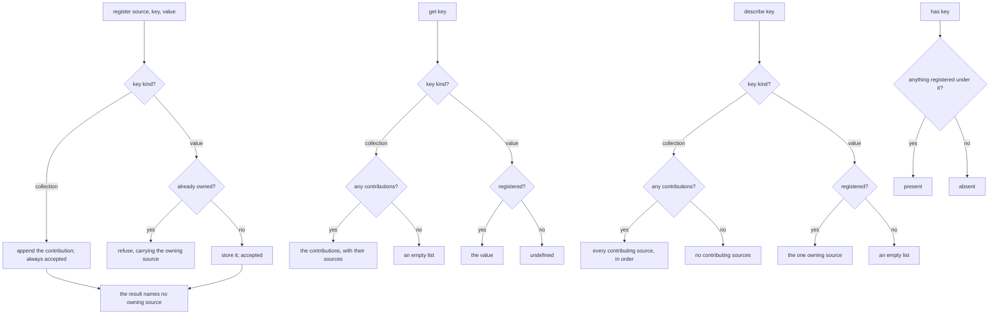
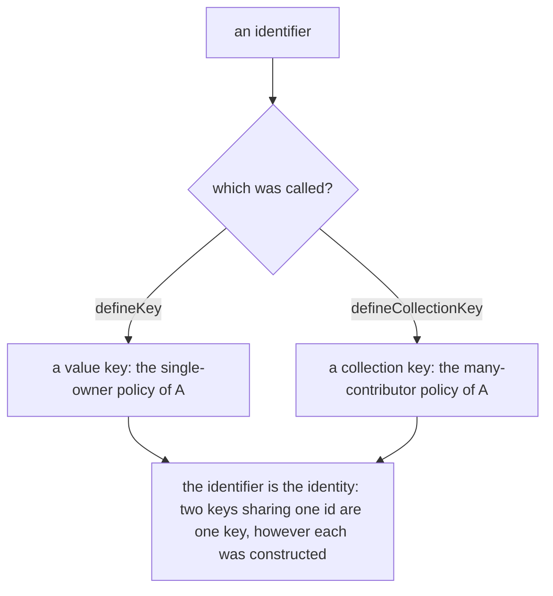

# Registry

Governs `src/plugins/registry.ts` — the typed key-value store through which
plugins and other extensions share contributions with one another.

## What

A plugin or an extension sometimes needs to publish a value another can find,
and to find what others published, without either knowing about the other. The
**registry** is that seam. It carries typed keys of two kinds, and the
difference between them is a policy decision made once: a **value** key is
single-owner and first-registration-wins, so two contributors claiming the same
responsibility is a conflict the second one is told about rather than a silent
overwrite; a **collection** key accepts every contribution, so contributors can
add to a list without knowing about each other.

The registry is reached as `this.registry` in a command's `run`, and through
the context an extension receives (`execution` UC7). Loading plugin packages
and the activation context a plugin receives are not core's: they live in
`@clibuilder/plugins` (`packages/plugins`, its `loading/` node), which uses this
registry. The folder was `plugins/` before v12.

**Non-goals.** Deciding when to run an extension, and registering commands into
the tree, belongs to `execution/`. Reading the configuration belongs to
`configuration/`.

**Key terms.** A **contribution** is a registered value together with the
contributor that registered it — the **source**.

## Use Cases

**Actors.**

| Actor | Reaches this capability | Goal |
| --- | --- | --- |
| Extension or plugin author | `register` through the context | publish a value other contributors can find, under a policy that makes conflicts visible |
| Another contributor *(stakeholder — reads what this one registered)* | `get` / `has` on the registry | build on an earlier contribution, or detect that it is absent |
| Command author | `this.registry` in `run` | read what extensions registered |

The second contributor is the actor the registry exists for. Without it the
host could pass contributions back to itself directly; it is sharing between
contributors that makes the source, the conflict policy, and the two key kinds
necessary.

### UC1 — `createRegistry`: share contributions between plugins

**Actor / goal.** A plugin wants to publish a value other plugins can find, and
to find what others published, under a policy that makes conflicts visible.

| | |
| --- | --- |
| Trigger | `createRegistry()`, then `register` / `get` / `has` / `describe` |
| Inputs | a typed key and, to register, a source and a value |
| Outcome | the contribution is stored, or refused with the name of the current owner |

**Extensions.**

| Cause | Outcome |
| --- | --- |
| a value key is registered twice | the second is refused and told which source owns it — never a silent overwrite |
| a collection key is registered many times | every contribution is kept, in registration order |
| a key was never registered, read through `get` | a value key reads as undefined; a collection key reads as an empty list, so a caller can iterate without a null check |
| a key was never registered, read through `describe` | either kind reads as an empty list — `describe` answers with sources, and no sources is an empty list whatever the key kind |

### UC2 — `defineKey` / `defineCollectionKey`: declare a typed key

**Actor / goal.** A **plugin author** publishing a contract for **another
plugin** to build on wants a key carrying both its identity and the type of what
may be stored under it.

| | |
| --- | --- |
| Trigger | `defineKey<T>(id)` or `defineCollectionKey<T>(id)` |
| Inputs | an identifier |
| Outcome | a key whose kind selects the single-owner or the many-contributor policy |

**Extensions.** None — the call is total: it constructs a key and cannot fail.
Two keys sharing an id are the same key by design, which is how a plugin reaches
a contract it did not declare.

**Surface trace.**

| Element | Required by | May not combine with |
| --- | --- | --- |
| `createRegistry` / `RegistryOwner.register` | UC1 | — |
| `Registry.get` / `has` / `describe` | UC1 | — |
| `Registration.accepted` / `.source` | UC1 | `source` is meaningful only when `accepted` is false |
| `defineKey` / `defineCollectionKey` | UC2 | — |

## Control Flow

### Sub-graph A — the registry (`createRegistry`), entered by UC1

`has` is the one reader whose answer does not depend on the key's kind, so it is
drawn once rather than split.

### Sub-graph B — declare a key (`defineKey` / `defineCollectionKey`), entered by UC2

## Scenario map

### UC1 — `createRegistry`

| Edge | Path (Given) | Scenario |
| --- | --- | --- |
| store it; accepted | a value key not yet owned | `the first registration of a value key is accepted` |
| the result names no owning source | any accepted registration, of either key kind | `an accepted registration carries no owning source` |
| refuse, carrying the owning source | a value key already owned | `a second registration of a value key is refused and names the owner` |
| append the contribution; always accepted | a collection key | `every registration of a collection key is kept, in order` |
| the value | a registered value key | `reading a registered value key returns its value` |
| undefined | an unregistered value key | `reading an unregistered value key returns nothing` |
| the contributions with their sources | a registered collection key | `reading a collection key returns each contribution with its source` |
| an empty list | an unregistered collection key | `reading an unregistered collection key returns an empty list rather than nothing` |
| present | a registered key, of either kind | `a registered key is reported as present` |
| absent | an unregistered key, of either kind | `an unregistered key is reported as absent` |
| the one owning source | a registered value key | `describing a value key names its single owner` |
| an empty list | an unregistered value key | `describing an unregistered value key returns an empty list rather than nothing` |
| every contributing source, in order | a registered collection key | `describing a collection key names every contributor in order` |
| no contributing sources | an unregistered collection key | `describing an unregistered collection key returns an empty list rather than nothing` |

### UC2 — `defineKey` / `defineCollectionKey`

| Edge | Path (Given) | Scenario |
| --- | --- | --- |
| a value key: the single-owner policy | `defineKey` | `a key defined as a value takes the single-owner policy` |
| a collection key: the many-contributor policy | `defineCollectionKey` | `a key defined as a collection takes the many-contributor policy` |
| the identifier is the identity | two keys built separately from one id | `two keys sharing an identifier are the same key` |
