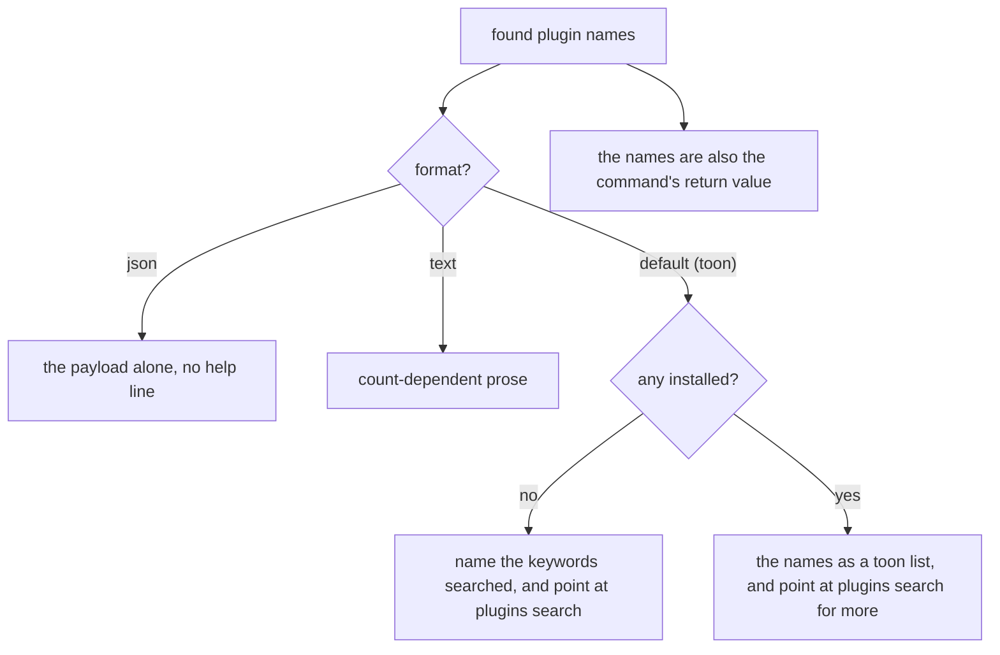
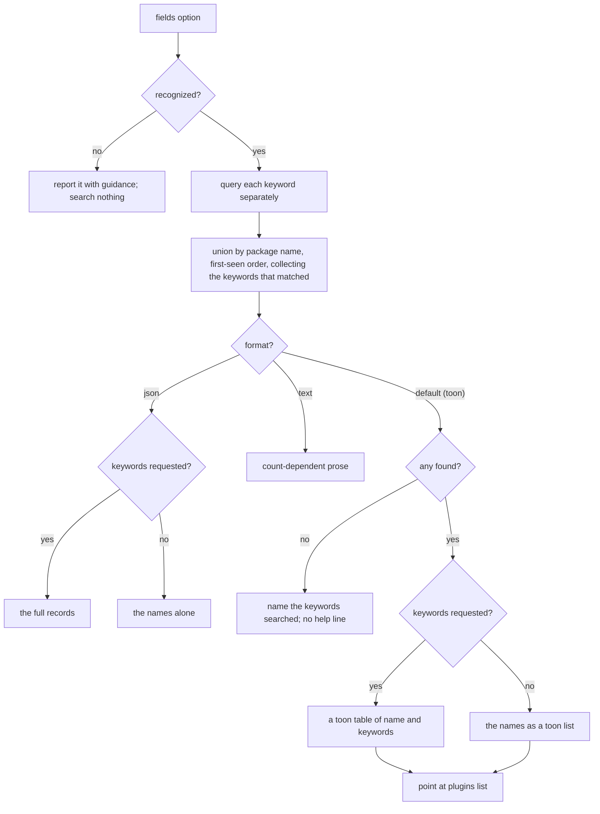
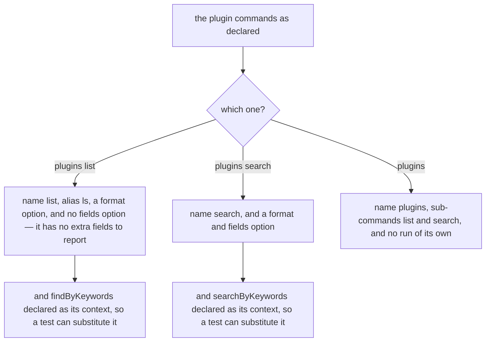
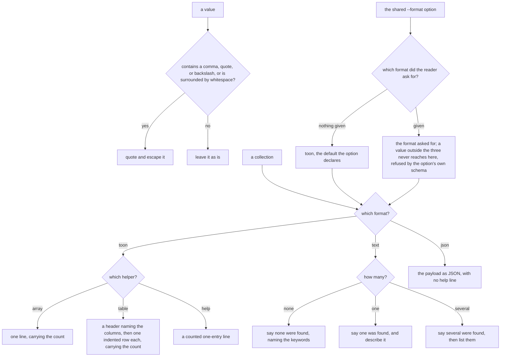

# Commands

Governs `src/commands/` — the `plugins list`, `plugins search` and `plugins`
commands that `plugins()` adds to a CLI, and the helpers they report through
(`format.ts`).

## What

Plugin discovery is the one thing a CLI author should not have to write:
`plugins list` lets a user see which plugins are installed, and `plugins search`
lets them find more. Both are added to a CLI by `plugins()` (`extension/`).

The output is written for **two readers at once**. A person wants prose. A
script or an agent wants a shape it can parse without branching on how many
results there turned out to be — so both structured formats report a list of one
as a list. Where they part is the empty result: the **default toon format**
names the keywords that were searched instead of printing an empty array,
because an agent that sees `packages[0]:` tends to retry with different flags to
check it did not filter the answer away, while **json** keeps the same shape it
always has, an empty list under the usual key, because a `| jq` consumer wants
one shape to parse rather than prose about why there was nothing.

These commands lived in `clibuilder` core until v12, where core's own
`builtin-commands/` node held their scenarios; the behaviour is unchanged.

**Non-goals.** Which packages `plugins()` loads belongs to `extension/`;
importing and activating them to `loading/`. How a command is matched and run
belongs to `packages/clibuilder` `execution/`; the global `--format` option and
how answers are encoded belong to its `presentation/`. This node decides *what*
to report and in which shape.

**Key terms.** A **format** is the reader's chosen output shape. A **help line**
is the trailing suggestion naming the next command to run. **Installed** means
present in the local package tree and carrying the keywords — what `plugins
list` reports. It is independent of activation: a package the configuration
never named is still installed, and `plugins list` finds it by keyword rather
than by anything the configuration says.

## Use Cases

**Actors.**

| Actor | Reaches this capability | Goal |
| --- | --- | --- |
| CLI end user | runs `plugins list` or `plugins search` | see what is installed, and find more to install |
| Agent or script reading the output | passes `--format json` or reads the default TOON | get a parseable answer, and a next step when the answer is empty |
| CLI author | adds `plugins()` | not implement plugin discovery |
| CLI author embedding `plugins list` | reads its return value | reuse the found names without parsing the printed report |

**Unserved goals — recovered from the issue tracker, not from the source.** A
backfill drawn from code yields only the goals already served, so this was
recovered separately. **It has no entry point today**, and so appears in neither
the Control Flow nor the suite:

| Actor | Goal | Provenance |
| --- | --- | --- |
| CLI end user | find installed plugins in a project with no `node_modules` — a Yarn PnP install | [#575](https://github.com/clibuilder/clibuilder/issues/575), split from [#327](https://github.com/clibuilder/clibuilder/issues/327). Loading and running plugins under PnP works; only keyword *discovery* fails, because it scans `node_modules` |

### UC1 — `plugins list`: report the installed plugins

**Actor / goal.** A user wants to know which plugins this CLI has available, and
what to do if there are none.

| | |
| --- | --- |
| Trigger | `plugins list`, or its alias `ls` |
| Inputs | the keywords (the `keywords` option of `plugins()`, or the cli's name); an optional format |
| Outcome | the installed plugin names, reported in the chosen format and returned to the caller |

**Extensions.**

| Cause | Outcome |
| --- | --- |
| nothing is installed | the report says so, naming the keywords searched, and points at `plugins search` — nothing installed says nothing about what exists on npm |
| the reader asked for JSON | the payload alone, with no trailing help line, so a `jq` consumer gets only what it asked for |
| the reader asked for text | count-dependent prose, which is what makes it read as English |
| the caller embeds the command | the found names are its return value as well as its output |
| the application runs with `output: 'axi'` | nothing goes through `ui`: the command returns the report as its answer, which the framework prints once on stdout — `result({ plugins }, { help })` with prose rendered under `text`, or `empty(...)` naming the keywords when nothing is installed ([axi-native RFC](../../../../../docs/rfcs/axi-native.md) section 3.5). `parse` resolves to `{ plugins }`, or to the empty message |

### UC2 — `plugins search`: find plugins on npm

**Actor / goal.** A user wants to discover plugins for this CLI that they have
not installed.

| | |
| --- | --- |
| Trigger | `plugins search` |
| Inputs | the keywords (the `keywords` option of `plugins()`, or the cli's name); an optional format; optional extra fields |
| Outcome | the packages found, reported in the chosen format |

**Extensions.**

| Cause | Outcome |
| --- | --- |
| the application declares several keywords | each is searched separately and the results unioned, because the underlying search matches packages carrying **all** the keywords it is given while the CLI wants any of them |
| a package matches several keywords | it appears once, carrying each keyword that matched it, in first-seen order |
| `--fields` names something unrecognized | it is reported with guidance and nothing is searched — silently narrowing the result is worse than an error |
| `--fields name` | accepted as a no-op, since the name is the row's identity and is always present |
| nothing is found | the keywords are named rather than an empty array printed |
| the application runs with `output: 'axi'` | nothing goes through `ui`: the command returns the report as its answer, printed once on stdout — `result({ packages }, { help })` with prose rendered under `text`, or `empty(...)` naming the keywords. An unrecognized `--fields` is a `CliError`, code `invalid-value`, exit 2 |

### UC3 — `plugins`: group the plugin commands

**Actor / goal.** A user wants the plugin commands under one obvious name.

| | |
| --- | --- |
| Trigger | `plugins` |
| Inputs | none |
| Outcome | help listing `list` and `search` |

**Extensions.** The group declares no `run`. What that produces — help, rather
than nothing — is `execution/`'s decision for any command without a `run`, and
is specified there; what this node owns is the declaration.

### UC4 — the format the plugins commands report in

**Actor / goal.** An agent or script wants the plugins commands to report in
the format it chose for the whole CLI, and a person running a plain CLI wants
`--format` on the command itself.

| | |
| --- | --- |
| Trigger | `plugins list` or `plugins search`, with or without `--format` |
| Inputs | whether the global `--format` of `clibuilder` is active (`output: 'axi'` or `cli({ format })`) |
| Outcome | the report, in the format that applies |

**Extensions.**

| Cause | Outcome |
| --- | --- |
| the global `--format` is active | the command's own `--format` is dropped instead of conflicting, its help does not list it, and it reports in `this.format` |
| the application runs with `output: 'axi'` | nothing goes through `ui`: the commands return their report as the answer, printed once on stdout (see UC1 and UC2) |
| the application runs in console output with no format | the command's own `--format` option, defaulting to toon, chooses the report |

The commands give way by carrying core's `defersToGlobalFormat` marker on their
`format` option.

### UC5 — the output helpers: render a reported collection

**Actor / goal.** A command reporting a collection wants one house style across
every command that reports one, in whichever format the reader asked for.

| | |
| --- | --- |
| Trigger | `toonArray` / `toonTable` / `toonHelp` / `reportProse`, and the shared `--format` option |
| Inputs | the collection and the reader's format |
| Outcome | the rendered lines |

**Extensions.**

| Cause | Outcome |
| --- | --- |
| a value contains a comma, quote, or backslash, or is surrounded by whitespace | it is quoted and escaped, so it cannot read as two entries |
| prose is asked for | the wording differs across none, exactly one, and several |
| a collection is rendered as TOON | the count is part of the syntax |

**Surface trace.**

| Element | Required by | May not combine with |
| --- | --- | --- |
| `listPluginsCommand` and its `ls` alias | UC1 | — |
| `searchPluginsCommand` | UC2 | — |
| `pluginsCommand` | UC3 | — |
| `--format` on both | UC1, UC2, UC4 | the global `--format` — when that is active, theirs gives way: it is dropped, and they read `this.format` |
| `--fields` | UC2 | — (declared on `plugins search` only; `plugins list` has no extra fields to report) |
| `findByKeywords` / `searchByKeywords`, declared as each command's `context` | UC1, UC2 — the seam a test substitutes, and what keeps the npm dependencies off the startup path | — |
| `toonValue` / `toonArray` / `toonTable` / `toonHelp` | UC5 | — (`toonTable` accepts a single column; preferring `toonArray` there is a token-cost choice, not a rule) |
| `reportProse` | UC5 | — |
| `formatOption` / `OutputFormat` / `OutputUI` | UC4, UC5 | — |

## Control Flow

### Sub-graph A — report the installed plugins (`plugins list`), entered by UC1

### Sub-graph B — search npm (`plugins search`), entered by UC2

### Sub-graph C — what the three plugin commands declare, entered by UC1, UC2 and UC3

The reporting logic above is reached only once a command has been matched; what
each command *declares* is the decision that gets it matched at all.

Declaring no `run` is what makes the bare group show help — but the showing is
`execution/`'s decision, so what this node specifies is the declaration.

### Sub-graph D — render a collection, entered by UC5

## Scenario map

### UC1 — `plugins list`

| Edge | Path (Given) | Scenario |
| --- | --- | --- |
| the names as a toon list | plugins installed, default format | `installed plugins are listed and point at search for more` |
| name the keywords searched | nothing installed, default format | `no installed plugins names the keywords searched and points at search` |
| the payload alone, no help line | JSON requested | `JSON output carries the payload and no help line` |
| the payload alone, no help line | JSON requested, nothing installed | `JSON output reports an empty result in the same shape as a full one` |
| count-dependent prose | text requested, reporting installed plugins | `text output reads as English about how many were found` |
| the names are also the command's return value | any | `the found names are the command's return value as well as its output` |
| name list, alias ls | any | `plugins list can be invoked as ls` |
| no fields option | any | `plugins list declares no fields option` |
| findByKeywords declared as its context | `plugins list` | `the discovery call is declared as context so a test can substitute it` |
| return the report as the answer, printed once on stdout | `output: 'axi'`, each format, nothing installed | `under output axi the plugins commands return their report as the answer` |

### UC2 — `plugins search`

| Edge | Path (Given) | Scenario |
| --- | --- | --- |
| name search, and a format and fields option | any | `plugins search declares both a format and a fields option` |
| searchByKeywords declared as its context | `plugins search` | `the npm search call is declared as context so a test can substitute it` |
| query each keyword separately | several declared keywords | `each keyword is searched separately so a package matching any of them is found` |
| union by package name, first-seen order, collecting the keywords that matched | a package matched by several keywords | `a package matched by several keywords is listed once carrying each` |
| report it with guidance | `--fields` names something unrecognized | `an unrecognized fields value is reported with guidance and nothing is searched` |
| recognized | `--fields name` | `asking for the name field is accepted as a no-op` |
| the names as a toon list | packages found, default format, no extra fields | `found packages are listed and point at plugins list` |
| a toon table of name and keywords | packages found, keywords requested | `asking for keywords reports a table of name and keywords` |
| name the keywords searched; no help line | nothing found, default format | `no packages found names the keywords searched rather than printing an empty list` |
| the names alone | JSON requested, no extra fields | `JSON output without extra fields carries the names alone` |
| the names alone | JSON requested, nothing found | `JSON output from search reports nothing found in the same shape as a full result` |
| the full records | JSON requested, keywords requested | `JSON output with keywords carries the full records` |
| count-dependent prose | text requested, reporting search results | `text output describes the packages found in prose` |
| return the report as the answer; an unknown `--fields` is a usage error on stdout | `output: 'axi'` | `under output axi the plugins commands return their report as the answer` |

### UC3 — `plugins`

| Edge | Path (Given) | Scenario |
| --- | --- | --- |
| no run of its own | any | `the plugins group declares no run of its own` |
| sub-commands list and search | any | `the plugins group carries list and search` |

### UC4 — the format the plugins commands report in

| Edge | Path (Given) | Scenario |
| --- | --- | --- |
| their own `--format` is dropped; they report in `this.format` | the global `--format` is active | `the plugins commands give way to the global format option` |
| return the report as the answer | `output: 'axi'` | `under output axi the plugins commands return their report as the answer` |
| their own `--format` chooses the report | console output, no format | `the plugins commands keep their own format option otherwise` |

### UC5 — the output helpers

| Edge | Path (Given) | Scenario |
| --- | --- | --- |
| quote and escape it | a value containing a comma, quote, or backslash | `a value that could read as two entries is quoted and escaped` |
| quote and escape it | a value surrounded by whitespace | `a value surrounded by whitespace is quoted` |
| leave it as is | an ordinary value | `an ordinary value is left unquoted` |
| one line, carrying the count | an array rendered | `a rendered array carries its count, so nothing looks truncated` |
| a header naming the columns, then one indented row each | a table rendered | `a rendered table names its columns and indents one row per entry` |
| a counted one-entry line | a help line rendered | `a help line is counted like any other rendered list` |
| say none were found | prose, empty collection | `prose for an empty collection names the keywords searched` |
| say one was found | prose, one item | `prose for one item describes it in the singular` |
| say several were found | prose, several items | `prose for several items lists them under a plural heading` |
| toon, the default the option declares | any command reporting a collection | `every plugins command reporting a collection offers the same three formats and defaults to toon` |
| the payload as JSON, with no help line | json asked for | `json output carries the payload alone` |
