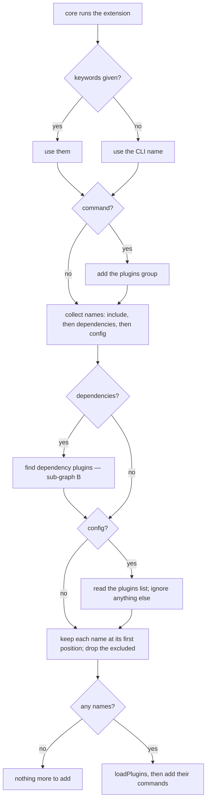
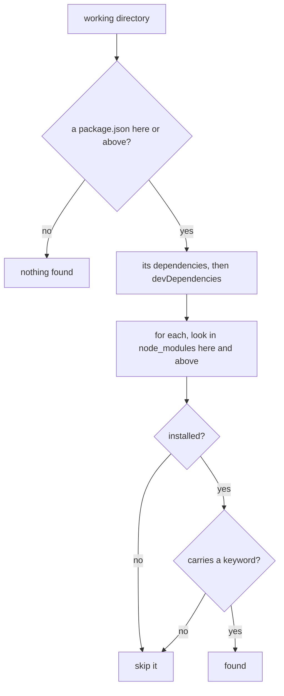

# Extension

Governs `src/plugins.ts`, `src/dependencies.ts`, and `src/commands/group.ts` —
the `plugins()` extension, where its plugin names come from, and the command
group it adds.

## What

`plugins()` is what a CLI author adds to get plugins. It returns an extension
for `cli().use()`; when core runs it, it adds the `plugins` command group and
loads plugins from up to three sources, then hands their commands to core.

Two properties shape the design. **Nothing is loaded that nobody chose**: the
sources are the author's own list (`include`), the user's config, and — only
when the author opts in — packages the project lists itself, never a package
pulled in by another package. And **the order is deterministic**: `include`,
then `dependencies` in `package.json` order, then config, each package once at
its first position.

**Non-goals.** Importing and activating a plugin is `loadPlugins`, whose
behaviour is this package's `loading/` node. What `plugins list` and `plugins
search` report is its `commands/` node; here they read their keywords from the
extension's options.

**Known gap — Yarn PnP.** The `dependencies` source finds a dependency's
`package.json` by walking `node_modules`, and so does `plugins list`. Under Yarn
PnP both find nothing (#575). One PnP-aware resolver should fix both; the two
places are marked in `src/dependencies.ts` and `src/commands/npm.ts`.

**Key terms.** A **source** is one of `include`, `dependencies`, `config`. An
**exclusion** is a config entry starting with `!`.

## Use Cases

**Actors.**

| Actor | Reaches this capability | Goal |
| --- | --- | --- |
| CLI author | `cli().use(plugins(options))` | give the CLI plugins, from the sources they choose |
| CLI end user | the `plugins` key in the CLI's config | add a plugin, or exclude one the CLI or project brings |
| Host building its own loading | `pluginsCommand({ keywords })`, `loadPlugins` | reuse the pieces without the extension |

### UC1 — `plugins()`: load plugins into a CLI

| | |
| --- | --- |
| Trigger | core runs the extension (execution UC7) |
| Inputs | `keywords`, `include`, `dependencies`, `config`, `command` |
| Outcome | the `plugins` group and the plugins' commands are added to the CLI |

**Extensions.**

| Cause | Outcome |
| --- | --- |
| `keywords` is omitted | the group looks for the CLI's name |
| `keywords` is given | the group looks for those keywords |
| `command` is `false` | no `plugins` group is added |
| `include` names packages | they load, with no config needed |
| config has a `plugins` list | the packages it names load |
| `config` is `false` | the `plugins` key is not read |
| the `plugins` key is not a list | it is ignored |
| `dependencies` is `true` | the direct dependencies carrying a keyword load |
| `dependencies` is omitted | no dependency is checked |
| a package is named by several sources | it loads once, at its first position |
| config names `!package` | that package does not load from any source |

### UC2 — the `dependencies` source

| | |
| --- | --- |
| Trigger | `plugins({ dependencies: true })` |
| Inputs | the working directory and the keywords |
| Outcome | the project's direct dependencies that carry a keyword |

**Extensions.**

| Cause | Outcome |
| --- | --- |
| packages under `dependencies` and `devDependencies` carry a keyword | they are found, `dependencies` first, in `package.json` order |
| a package carrying a keyword is installed but not listed | it is not found |
| the nearest `package.json` is above the working directory | it is the one read |
| a listed package is installed in an ancestor `node_modules` | it is found |
| a listed package is not installed, or declares no keywords | it is skipped |
| there is no `package.json` | nothing is found |

**Surface trace.**

| Element | Required by | May not combine with |
| --- | --- | --- |
| `plugins(options)` | UC1 | — |
| `plugins.Options.keywords` / `include` / `dependencies` / `config` / `command` | UC1, UC2 | — |
| `pluginsCommand({ keywords })` | UC1 | — |
| `loadPlugins` | UC1 | — |
| `PluginActivationContext` | UC1 — the type a plugin's `activate` receives | — |

## Control Flow

### Sub-graph A — `plugins()`, entered by UC1

### Sub-graph B — the `dependencies` source, entered by UC2

## Scenario map

### UC1 — `plugins()`

| Edge | Path (Given) | Scenario |
| --- | --- | --- |
| use the CLI name | no keywords | `the plugins group looks for the CLI name by default` |
| use them | keywords | `the plugins group looks for the keywords it is given` |
| command? no | `command: false` | `no plugins group is added when told not to` |
| collect names: include | `include` | `included plugins load without any config` |
| read the plugins list | a config `plugins` list | `the plugins named in config load` |
| config? no | `config: false` | `the plugins key is ignored when config is turned off` |
| ignore anything else | a `plugins` key that is not a list | `a plugins key that is not a list is ignored` |
| dependencies? yes | `dependencies: true` | `direct dependencies carrying a keyword load only when asked to` |
| keep each name at its first position | a package in several sources | `sources load in order, each package once` |
| drop the excluded | a `!` entry | `config can exclude a plugin from the other sources` |
| loadPlugins, then add their commands | a CLI using `plugins()` | `a CLI loads plugins through use()` |

### UC2 — the `dependencies` source

| Edge | Path (Given) | Scenario |
| --- | --- | --- |
| found | listed and carrying a keyword | `listed dependencies carrying a keyword are found in package.json order` |
| skip it | installed but not listed | `an unlisted package is never checked` |
| look in node_modules here and above | hoisted, with `package.json` above cwd | `the nearest package.json and ancestor node_modules are used` |
| skip it | not installed, or no keywords | `a missing package or one without keywords is skipped` |
| nothing found | no `package.json` | `nothing is found without a package.json` |
