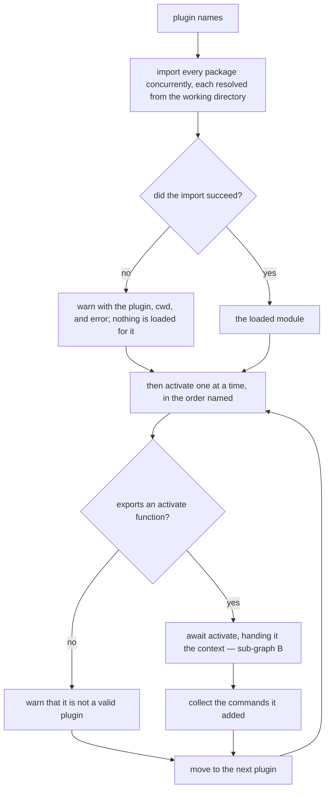
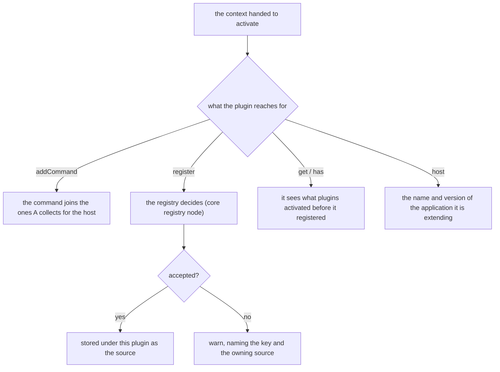

# Loading

Governs `src/load.ts`, `src/resolve_plugin.ts` and `src/types.ts` — importing
the plugin packages a configuration names, activating them, and accepting the
commands and other contributions they register.

## What

A plugin lets someone extend a CLI they did not write and cannot recompile. The
host names the packages in its configuration; this capability imports each one,
hands it a narrow activation context, and collects whatever it contributes. The
`plugins()` extension (`extension/`) decides which packages to load and calls
`loadPlugins`; this node is what happens to each one.

Two properties shape the design. **A bad plugin must not take the host down** —
a package that fails to import, or that turns out not to be a plugin at all, is
reported and skipped, because a user with three plugins installed should not
lose the CLI to one of them being broken. And **contributions are ordered
deterministically**: the modules are imported concurrently, since import is I/O
and the order of that I/O is not observable, but they are *activated* one at a
time in the order the configuration named them, so the resulting command list is
the same on every run.

Packages are resolved from the working directory, where the project that lists
them installed them, not from where `clibuilder` itself happens to sit — which
is out of the project's reach under `npx`, a global install, or a bundle.

The registry the context exposes is `clibuilder`'s (`packages/clibuilder`
`registry/` node): value keys are single-owner, collection keys accept every
contribution. This node specifies only how the context hands it to a plugin.

**Non-goals.** Which packages to load, and from which sources, belongs to
`extension/`. Reading the configuration belongs to `packages/clibuilder`
`configuration/`. The registry itself belongs to `packages/clibuilder`
`registry/`.

**Key terms.** **Activation** is calling a plugin module's `activate` with the
context. A **contribution** is a registered value together with the plugin that
registered it — the **source**. The **host** is the CLI a plugin is extending,
named and versioned so a plugin can adapt to it.

## Use Cases

**Actors.**

| Actor | Reaches this capability | Goal |
| --- | --- | --- |
| Plugin author | exports `activate` | add commands and values to a host CLI without compiling against it |
| `plugins()` extension | calls `loadPlugins` | get the commands the named plugins contribute |
| CLI end user | installs a plugin package and names it in config | see the plugin's commands appear, and be told when one is broken rather than losing the CLI |
| Another plugin *(stakeholder — reads what this one registered)* | `get` / `has` on the registry | build on an earlier plugin's contribution, or detect that it is absent |

### UC1 — `loadPlugins`: activate the configured plugins

**Actor / goal.** The `plugins()` extension wants the commands contributed by the packages the
configuration named, in a deterministic order, without a broken package taking
down the CLI.

| | |
| --- | --- |
| Trigger | `loadPlugins({ cwd, ui, registry, host }, pluginNames)` |
| Inputs | the plugin package names, a registry to contribute to, and the host's identity |
| Outcome | the contributed commands, in plugin order |

**Extensions.**

| Cause | Outcome |
| --- | --- |
| the package is installed in the working directory | it is resolved from there |
| the package is not installed in the working directory | its name is imported as given, so a plugin installed beside the cli still loads |
| a package cannot be imported | a warning names the plugin, the working directory, and the underlying error, and it is skipped |
| a package cannot be imported | **a second warning also says it is not a valid plugin** — see the gap below |
| an imported module has no `activate` function | a warning says it is not a valid plugin, and it is skipped |
| `activate` is asynchronous | it is awaited before the next plugin is activated |
| several plugins contribute commands | the commands appear in the order the plugins were named |

### UC2 — the activation context: what a plugin may do

**Actor / goal.** A plugin author wants a narrow, stable surface for
contributing, and wants to know which host they are running inside.

| | |
| --- | --- |
| Trigger | the host calls the plugin's `activate(context)` |
| Inputs | the activation context |
| Outcome | the plugin's commands and registrations are collected |

**Extensions.**

| Cause | Outcome |
| --- | --- |
| the plugin adds a command | it is collected and returned to the host |
| the plugin registers under a key already owned | a warning names the key and the plugin that owns it; the registration is not applied |
| the plugin reads a key | it sees contributions made by plugins activated before it |

### UC3 — a plugin runs in a real process

**Actor / goal.** A CLI end user runs a CLI whose config names a plugin, and
expects the plugin's command to work in a process of its own — resolved from
the project, whichever module format the plugin ships, and exiting when done.

| | |
| --- | --- |
| Trigger | a fixture CLI (`cli({ config: true }).use(plugins())`) is run with `node bin.js` from its own folder, its config naming a plugin |
| Inputs | the plugin package in the fixture's `node_modules`, and the command line |
| Outcome | the plugin's command runs and the process exits with code 0 |

**Extensions.**

| Cause | Outcome |
| --- | --- |
| the plugin is CommonJS | it loads and its command runs |
| the plugin is an ES module | it loads and its command runs |
| the plugin's command is asynchronous ([#286](https://github.com/clibuilder/clibuilder/issues/286)) | the process exits on its own once the command resolves, rather than staying alive |

**Surface trace.**

| Element | Required by | May not combine with |
| --- | --- | --- |
| `loadPlugins` | UC1 | — |
| `resolvePlugin` | UC1 | — |
| `PluginActivationContext.addCommand` | UC2 | — |
| `PluginActivationContext.register` / `get` / `has` | UC2 | — |
| `PluginActivationContext.host` | UC2 | — |

## Control Flow

### Sub-graph A — load and activate (`loadPlugins`), entered by UC1

Every package is imported at once; activation is then sequential, so the order
the plugins were named is the order their commands appear in.

**Known gap — an unimportable plugin is reported twice.** A failed import
yields nothing, and nothing does not export `activate`, so the same plugin
takes the `no` branch of both decisions: it is warned about as unloadable and
then warned about again as not a valid plugin. The suite fixes that as current
behavior; it is filed as a defect in this spec's ledger.

### Sub-graph B — the activation context, entered by UC2

## Scenario map

### UC1 — `loadPlugins`

| Edge | Path (Given) | Scenario |
| --- | --- | --- |
| activate one at a time, in the order named | several plugins contributing commands | `commands appear in the order the plugins were named` |
| warn with the plugin, cwd, and error | a package that cannot be imported | `a plugin that cannot be imported is reported and skipped` |
| warn that it is not a valid plugin | a module with no activate function | `a module that is not a plugin is reported and skipped` |
| warn that it is not a valid plugin | a package that cannot be imported | `a plugin that cannot be imported is also reported as not a valid plugin` |
| move to the next plugin | one broken plugin among working ones | `a broken plugin does not stop the others from activating` |
| await activate | a plugin whose activate is asynchronous | `an asynchronous activate is awaited before the next plugin` |
| import every package concurrently, each resolved from the working directory | a plugin installed in the working directory | `a plugin is resolved from the working directory` |
| import every package concurrently, each resolved from the working directory | a plugin not installed in the working directory | `a plugin not installed in the working directory is imported by the name given` |
| collect the commands it added | a plugin adding commands | `the commands a plugin adds are returned to the host` |

### UC2 — the activation context

| Edge | Path (Given) | Scenario |
| --- | --- | --- |
| stored under this plugin as the source | a plugin registering a free key | `a value a plugin registers is recorded under that plugin as its source` |
| warn, naming the key and the owning source | a plugin registering an owned key | `a plugin registering an already-owned key is told which plugin owns it` |
| it sees what plugins activated before it registered | a plugin activated after another | `a plugin can read what an earlier plugin registered` |
| the name and version of the application it is extending | any | `a plugin is told the name and version of the host it is extending` |

### UC3 — a plugin runs in a real process

| Edge | Path (Given) | Scenario |
| --- | --- | --- |
| it loads and its command runs | a CommonJS plugin the config names | `a CommonJS plugin loads and runs in a real process` |
| it loads and its command runs | an ES module plugin the config names | `an ES module plugin loads and runs in a real process` |
| the process exits on its own | an asynchronous plugin command | `the process exits after an asynchronous plugin command resolves` |
